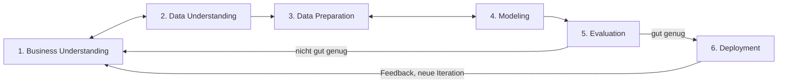

# CRISP-DM für das Vergabe-Radar

Dieses Projekt folgt dem CRISP-DM-Modell (Cross-Industry Standard Process for
Data Mining). Die sechs Phasen werden nicht einmal linear abgearbeitet, sondern
in mehreren Iterationen durchlaufen. Jede Iteration endet mit einer Bewertung,
die entscheidet: weiter, zurück in eine frühere Phase oder Idee anpassen.

---

## Die sechs Phasen

### 1. Business Understanding

**Ziel:** Klären, welches Problem für wen gelöst wird und woran Erfolg gemessen wird.

**Leitfragen**
- Wer genau ist der Kunde (Branche, Größe, Region)?
- Welche Entscheidung soll unsere Prognose ermöglichen, und wie früh muss sie kommen?
- Was ist der Kunde bereit zu zahlen?

**Aufgaben im Vergabe-Radar**
- Zielnische festlegen (Kandidaten: Gebäudereinigung, IT-Wartung, Winterdienst, Kantinenbetrieb).
- Kundengespräche führen (Ziel: 5 bis 10 pro Nische).
- Wettbewerber prüfen (Ausschreibungsdienste wie DTAD: Bieten sie Prognosen an?).
- Geschäftliche und technische Erfolgskriterien festlegen.

**Ergebnisse (Artefakte)**
- `docs/business.md`: Zielgruppe, Problem, Erfolgskriterien, Gesprächsnotizen.

**Weiter, wenn:** Nische und messbare Erfolgskriterien schriftlich feststehen.

---

### 2. Data Understanding

**Ziel:** Verstehen, welche Daten es gibt, wie gut sie sind und was sie hergeben.

**Leitfragen**
- Welche Felder liefert die TED-API für Zuschlagsbekanntmachungen?
- Wie oft sind Laufzeit, Verlängerungsoptionen, CPV-Code, Auftraggeber und Auftragswert befüllt?
- Wie weit zurück sind die Daten brauchbar (eForms seit Herbst 2023, ältere Formate weniger strukturiert)?
- Welche CPV-Bereiche sind häufig?

**Aufgaben im Vergabe-Radar**
- Rohdaten über die TED-API abrufen und unverändert in `data/raw` speichern.
- Datenqualitätsreport erstellen (Befüllungsquoten, Verteilungen, Auffälligkeiten).
- Stichproben einzelner Bekanntmachungen manuell lesen, um Felder richtig zu deuten.

**Ergebnisse (Artefakte)**
- `reports/datenqualitaet.md` mit Kennzahlen und Beispielen.
- Skripte in `src/ingest/`.

**Weiter, wenn:** Für die gewählte Nische genug Datensätze mit verwertbarer Laufzeit vorliegen.
**Zurück zu Phase 1, wenn:** Die Daten für die Nische nicht reichen (andere Nische wählen).

---

### 3. Data Preparation

**Ziel:** Aus Rohdaten einen sauberen, analysierbaren Datensatz bauen.

**Aufgaben im Vergabe-Radar**
- Relevante Felder extrahieren und in eine Tabelle überführen (eine Zeile pro Vertrag oder Los).
- Laufzeiten vereinheitlichen (Monate, Jahre, Start- und Enddatum).
- Verlängerungsoptionen strukturiert erfassen.
- Auftraggeber normalisieren (gleiche Behörde, unterschiedliche Schreibweisen).
- Nach CPV-Codes der Nische filtern.
- Spätere Neuausschreibungen den ursprünglichen Verträgen zuordnen (Grundlage für den Backtest).

**Ergebnisse (Artefakte)**
- `data/processed/` mit bereinigten Tabellen (nicht im Git).
- Skripte in `src/prepare/`, dokumentierte Bereinigungsregeln.

**Weiter, wenn:** Der Datensatz reproduzierbar per Skript aus den Rohdaten entsteht.
**Zurück zu Phase 2, wenn:** Neue Datenprobleme auftauchen, die erst verstanden werden müssen.

---

### 4. Modeling

**Ziel:** Das erwartete Datum der Neuausschreibung prognostizieren.

**Vorgehen in Stufen (einfach vor komplex)**
1. **Baseline-Regel:** Neuausschreibung ≈ Vertragsbeginn + Laufzeit − übliche Vorlaufzeit.
2. **Erweiterte Regel:** Verlängerungsoptionen berücksichtigen (mit und ohne Ausübung).
3. **Historische Muster:** Ausschreibungszyklen desselben Auftraggebers einbeziehen.
4. **Statistisches oder ML-Modell:** Nur wenn die Regeln klar an Grenzen stoßen.

**Ergebnisse (Artefakte)**
- Skripte in `src/model/`, jede Modellvariante mit Kurzbeschreibung.

**Zurück zu Phase 3, wenn:** Das Modell zusätzliche oder anders aufbereitete Merkmale braucht.

---

### 5. Evaluation

**Ziel:** Prüfen, ob die Prognosen gut genug für den geschäftlichen Zweck sind.

**Methode: Backtest**
- Für ältere Verträge die Neuausschreibung prognostizieren.
- Mit den tatsächlich erschienenen Neuausschreibungen vergleichen.

**Kennzahlen (Vorschlag, in Phase 1 final festlegen)**
- **Trefferquote:** Anteil der tatsächlichen Neuausschreibungen, die im prognostizierten Zeitfenster (z. B. ±3 Monate) lagen.
- **Präzision:** Anteil der Prognosen, auf die tatsächlich eine Neuausschreibung folgte.
- **Vorlauf:** Wie viele Monate vor Veröffentlichung die Prognose verfügbar war.

**Entscheidung am Ende jeder Iteration**
- Gut genug → Phase 6.
- Nicht gut genug → zurück zu Phase 1 (Ziel oder Nische anpassen), 3 (Daten) oder 4 (Modell).
- Grundsätzlich nicht tragfähig → Idee ehrlich verwerfen oder umbauen.

**Ergebnisse (Artefakte)**
- `reports/backtest_iterationN.md` mit Kennzahlen, Beispielen für Treffer und Fehlprognosen.

---

### 6. Deployment

**Ziel:** Ergebnisse so bereitstellen, dass echte Kunden sie nutzen und Feedback geben.

**Stufen**
1. Manuell erzeugte Liste als PDF oder Tabelle für Testkunden.
2. Automatisierte monatliche Liste per E-Mail.
3. Einfaches Dashboard, erst wenn zahlende Kunden es verlangen.

**Aufgaben im Vergabe-Radar**
- Pipeline von Datenabruf bis Liste automatisieren.
- Feedback der Testkunden sammeln (Nutzen, Fehler, Zahlungsbereitschaft).

**Ergebnisse (Artefakte)**
- Skripte in `src/report/`, Beispielausgabe in `reports/beispiel_liste.md`.

**Danach:** Feedback fließt in die nächste Iteration von Phase 1.

---

## Iterationsplan

| Iteration | Fokus | Phasen | Ergebnis |
|---|---|---|---|
| 1 | Machbarkeit | 1 → 2 | Datenqualitätsreport, Entscheidung für eine Nische |
| 2 | Erste Prognose | 3 → 4 → 5 | Baseline-Regel mit Backtest-Kennzahlen |
| 3 | Verbesserung | 3 → 4 → 5 | Verlängerungsoptionen und Auftraggeber-Historie, besserer Backtest |
| 4 | Erster Kundentest | 6 → 1 | Testliste für Kunden, Feedback, Preis-Hypothese |
| 5+ | Ausbau | je nach Bewertung | weitere Nischen, Automatisierung, ggf. ML |

Die Gespräche mit potenziellen Kunden (Phase 1) laufen parallel zu allen
Iterationen weiter, nicht nur am Anfang.

---

## Arbeitsregeln

- Zu Beginn jeder Aufgabe benennen, in welcher Phase und Iteration wir uns befinden.
- Am Ende jeder Iteration eine kurze Notiz in `docs/iterationen.md` ergänzen:
  Was wurde gemacht, was kam heraus, welche Entscheidung folgt daraus.
- Rücksprünge in frühere Phasen sind normal und gewollt, kein Scheitern.
- Einfache Lösungen zuerst; Komplexität nur, wenn die Evaluation sie begründet.
