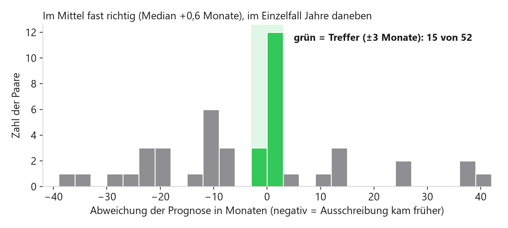
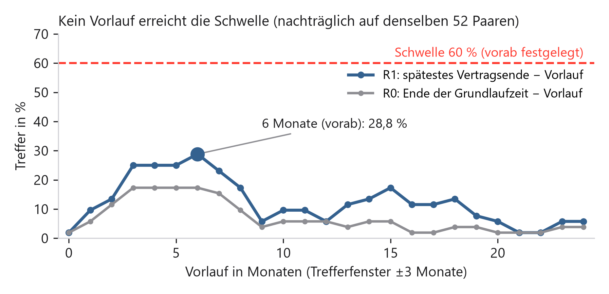
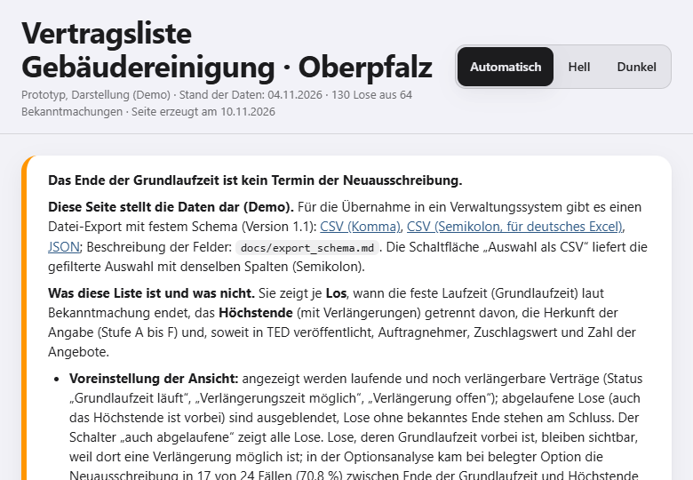
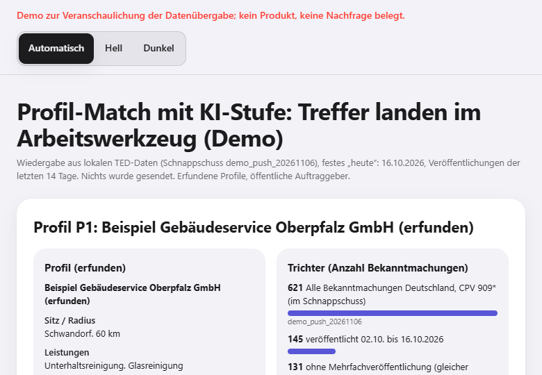
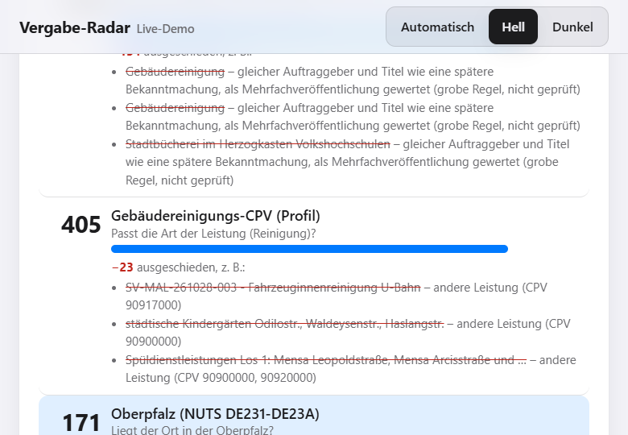
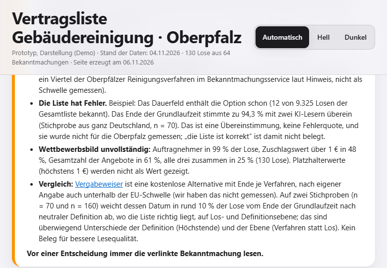
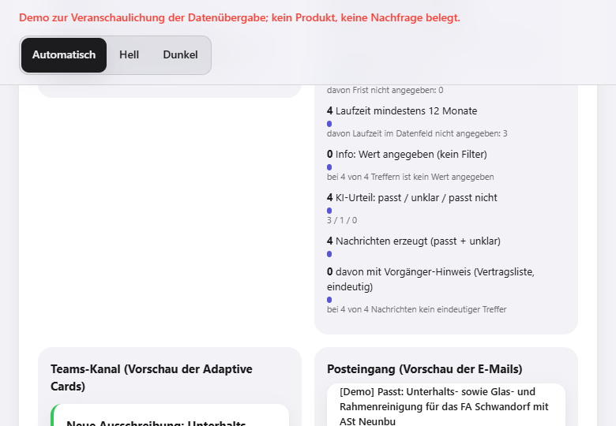
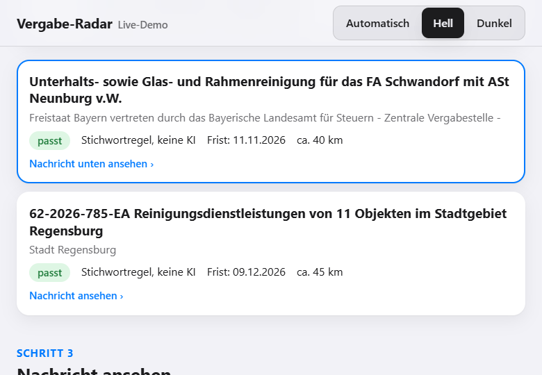
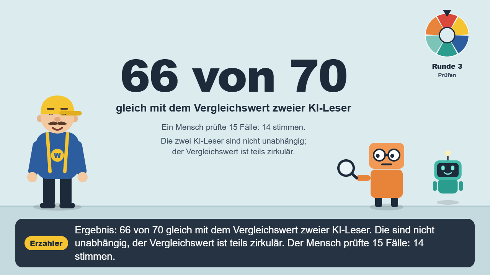

# Lab-Log: Vergabe-Radar

**Manuel Strobel · Ludwig Richthammer** · OTH Amberg-Weiden, Big Data Analytics · Leistungsnachweis B (Zweierteam) · Abgabe 10.11.2026

Repository: https://github.com/ludwigrichthammer9-web/vergabe_radar · Folien: `docs/vortrag/vortrag_vergabe_radar.pdf` · Video: `docs/video/franz_video_ton_kurz.mp4` (Vortragsfassung, 3:32; vollständige Fassung 4:28: `docs/video/franz_video_ton.mp4`)

_Chronologisch nach CRISP-DM-Zyklen. Zahlen und Quellen stehen in `docs/iterationen.md`, `docs/business.md`, `docs/phasen/` und `reports/`; hier steht die Erzählung mit den Entscheidungen. Fakten und Deutung sind getrennt gekennzeichnet. Hauptteil: Abschnitte 0 bis 11 und Glossar (bis vor Anhang A). Anhänge: A Seeds, Hashes und Commits; B alle KI-Irrwege; C Ergebnisse zum Anfassen (Tabelle, Bilder, Video); D Zeitaufwand im Detail; E K-J mit Punkten und Quellen. Das Glossar der Begriffe und Kennungen steht am Ende des Hauptteils (nach Abschnitt 11). „Wir“ = beide Teammitglieder (gemeinsam im Call); Einzelarbeiten sind mit Namen genannt; Claude Code = KI-Assistenz. Stand: 2026-11-09._

| Bewertungskriterium | Abschnitt | Bewertungskriterium | Abschnitt |
|---|---|---|---|
| Business Understanding | §1, Anhang E (K-J) | KI-Irrwege und ihre Prüfung | §8, Anhang B |
| Data Understanding/Preparation | §2 mit „Datenqualität auf einen Blick“; §3 (Leakage) | Beiträge beider Teammitglieder | §9 |
| Modeling/Evaluation (Baseline, Schwellen) | §3 bis §5 | Zeitaufwand je Arbeitsschritt | §10, Anhang D |
| Iteratives Vorgehen | §0 mit Tabelle der Zyklen und Phasen je Zyklus | Reproduzierbarkeit, Daten, Quellen | §11, Anhang A und E |
| Empfehlung mit Grenzen | §7 | Ergebnisse zum Anfassen (Webseite, Demo, Video) | §6, Anhang C (Tabelle, Bilder) |

> **Ergebnis auf einen Blick.** Wir wollten wissen, ob sich aus den Bekanntmachungen vergebener öffentlicher Aufträge (Zuschlagsbekanntmachungen in TED, Tenders Electronic Daily, dem EU-Amtsblatt für Ausschreibungen) vorhersagen lässt, wann ein Reinigungsvertrag in Deutschland neu ausgeschrieben wird, damit sich ein Mittelständler (Beispiel Gebäudereinigung) früh vorbereiten kann, und ob eine Liste auslaufender Verträge ein Produkt wäre, das sich vom Markt abhebt. Geprüft haben wir drei Ansätze gegen vorab festgelegte Schwellen: neue Aufträge ihren Vorgängern zuordnen, den Termin der Neuausschreibung berechnen und eine Liste der Vertragsenden bauen.
>
> 1. **Der Termin lässt sich nicht vorhersagen.** Die beste einfache Regel trifft das Fenster ±3 Monate in 28,8 % der 52 geprüften Fälle (Schwelle 60 %, naive Referenz 17,3 %).
> 2. **Das Vertragsende lässt sich meist aus der Bekanntmachung lesen („laut Bekanntmachung“).** 6.803 von 9.325 Losen (rund 73 %) haben ein Ende der Grundlaufzeit (Abschnitt 4); bei 66 von 70 Stichprobenlosen (94,3 %) ist es gleich wie der Vergleichswert zweier KI-Leser (Mensch aus dem Team 14/15; „die Liste ist korrekt“ ist nicht belegt).
> 3. **Diese Liste gibt es schon,** kostenlos (Vergabeweiser) und günstig (AusschreibungsRadar). Belegt ist nur ein Merkmalsunterschied (Ende je Los, Grundlaufzeit statt Höchstende): Auf zwei Stichproben weicht Vergabeweiser bei 27 von 230 Losen ab (11,7 %), bei 23 (10,0 %) liegt nur unsere Liste richtig; ein Qualitätsvorteil beim Lesen ist nicht belegt. Zahlungsbereitschaft zeigte sich in einem von drei Gesprächen und nur für Wettbewerbsdaten; die Business-Case-Prüfung ergab keinen tragfähigen Business Case.
>
> **Rat: Die Liste als Hilfsmittel nutzen und kein eigenes Produkt bauen; für einen Reinigungsbetrieb ist „kostenlos nutzen“ im Modell mit Annahmen besser als „selbst bauen“.** Grenzen: nur drei Gespräche, die KI-Leser sind nicht unabhängig, ob jemand für die Liste zahlt, ist ungeprüft.

## 0. Überblick

**Verlauf.** Zehn Iterationen in vier Zyklen; danach (2026-11-06 bis 11-09) Business-Case-Auswahl, Demo, Live-Demo, Video und Folienumbau (Abschnitt 5 und 6). Die Entscheidung am Ende jeder Iteration (weiter, zurück zu Phase X, Idee anpassen) war vorab an Schwellen gebunden, die vor dem Ergebnis committet wurden. Zyklus 4 entstand, weil der Dozent mehr Gewicht auf Business Understanding verlangte.

| Zyklus | Iterationen | Leitfrage | Ergebnis |
|---|---|---|---|
| 1 | 1 bis 4 | Lässt sich ein neuer Auftrag seinem Vorgänger zuordnen? | Nein, jede Variante verfehlte die Schwelle; Idee angepasst |
| 2 | 5 | Trägt eine einfache Terminprognose? | Nein (28,8 % statt 60 %); Idee angepasst auf eine Vertragsliste |
| 3 | 6 bis 9 | Wie genau ist die Vertragsliste? | Brauchbar, zuletzt 94,3 % Übereinstimmung mit zwei KI-Lesern; nicht als korrekt belegt |
| 4 | 10 und 10b (mit Paketen A bis D und F, drei Gesprächen, Nebentest) | Was bietet der Markt schon, und hebt sich die Liste ab? Was ändert die Sicht des Betriebs (selbst filtern)? | Kernprodukt gibt es kostenlos; belegt ist nur ein Merkmalsunterschied; Eigenbau gegen kostenlose Dienste im Modell (Annahmen) nie günstiger (Modellkonstruktion); Nachfrage offen |

**CRISP-DM-Phasen je Zyklus** (Einzelheiten in den Abschnitten 2 bis 5; „–“ = in diesem Zyklus nicht bearbeitet).

| Zyklus | 1 Business Understanding | 2 Data Understanding | 3 Data Preparation | 4 Modeling | 5 Evaluation | 6 Deployment |
|---|---|---|---|---|---|---|
| 1 (It. 1–4) | Nische Gebäudereinigung, Ziel Vorgänger finden | Befüllung der TED-Felder, Platzhalter | Zuschlagstabelle, Objekttexte | Zuordnungsregeln (Auftraggeber, Objekt) | Blindprüfung, Handsuche; Schwellen verfehlt | – (entfällt) |
| 2 (It. 5) | Prognoseziel und Schwelle vorab (±3 Monate, 60 %) | Laufzeitfelder, Vorgänger vor eForms | Paare Vorgänger/Neuausschreibung | Regel R1 gegen Baseline R0 | 52 Paare, Zweitprüfung; 28,8 % | – (entfällt) |
| 3 (It. 6–9) | Produktkern: Liste statt Prognose | Fehlerarten im Enddatum | Leseregeln 1b, 6 bis 10 | Regelbasierte Liste (Stufen A–F) | Neue Stichproben, KI-Leser, Teammitglied; 66 von 70 gleich wie der Vergleichswert | Prototyp Webseite (Abschnitt 6) |
| 4 (It. 10/10b) | Rücksprung: Konkurrenz, Sicht des Betriebs, Gespräche | Vergabeweiser-API, Bekanntmachungsservice | Abgleich je Los | – (keine neue Regel) | Pakete A–D, F, Auswahlbogen | Nur Veranschaulichung: Demo, Live-Demo, Video |

**Grenzen vorweg.** Vor Iteration 10 gab es keinen Kundenkontakt (unsere Entscheidung, 2026-10-29); dann folgten drei kurze Telefonate (Hinweise, keine Stichprobe). Ob jemand für eine solche Liste zahlt (A1, A15), ist ungeprüft. Die Vertragsliste und ihre Prüfungen (Iteration 6 bis 10b) beruhen auf eForms-Bekanntmachungen ab 25.10.2023. Der Backtest der Iteration 5 nutzt auch ältere TED-Formulare: 41 der 52 Vorgänger stammen aus der Zeit vor eForms (`reports/backtest_iteration5.md`). Alle Messungen gelten nur oberhalb der EU-Schwelle, Haupt-CPV 909, Deutschland.

## 1. Business Understanding im Überblick

_Kurzfassung für den Dozenten. Quellen: `docs/business.md` §6 bis §8, `reports/wettbewerbsbild_oberpfalz.md`. Angaben aus Web-Recherche eines KI-Agenten und eines KI-Gutachtens sind nur dort „geprüft“, wo `docs/business.md` es vermerkt._

**Rahmen: die Entscheidung eines Gebäudereinigungsunternehmens (von uns gewählte Sicht).** Ein Betrieb, der für Kommunen und Behörden bietet, fragt: _Selbst bauen, kostenlos nutzen oder abonnieren?_ (Make or Buy). Kosten und Break-even rechnen wir nur mit Annahmen (Aufwand, Stundensatz, Pflege nicht gemessen; `reports/make_or_buy.md`); dass Eigenbau gegen kostenlose Dienste „nie günstiger“ ist, ist eine Modellkonstruktion und keine Messung. Ob es einen tragfähigen Business Case gibt, prüften wir mit einem vorab festgelegten Auswahlbogen (`docs/business_case_auswahl.md`).

**Ergebnis der Business-Case-Prüfung (Fakten, 2026-11-06 bis 11-09).**
- _Auswahlbogen:_ Neun Kandidaten wurden nach sieben Kriterien mit je 0 bis 2 Punkten bewertet (höchstens 14; Schwelle 8, vorab): K-A bis K-H zuerst, K-I (Push-Matching) danach als Nachtrag (6 Punkte, nach unserem Gegencheck 7; K7 = 0, damit als Kern ausgeschlossen; `docs/business_case_auswahl.md`). Die höchste zulässige Summe war 7 (K-A, Amtsinhaber-Quote), also unter 8: **kein tragfähiger Business Case.** Die Kriterien wurden festgelegt, nachdem die Recherchen vorlagen (Bestätigungsgefahr).
- _Test K-A abgebrochen:_ Nach der vorab festgelegten Regel (Abbruch unter 30 verwertbaren Paaren) hatten nur 23 von 52 Paaren einen Zuschlag des Nachfolgers.
- _Nachtrag K-J_ (Push in Teams, Outlook, Planner per Power Automate; Evaluation 2026-11-08/09): Den Ablauf gibt es schon kostenlos (TED-Suchprofile mit E-Mail-Alarm, Vergabeweiser-Alerts, Weiterleitung per Standard-Flow), und das Problem „Suchaufwand“ ist in den drei Gesprächen nicht belegt. Punkte streng 5, wohlwollend 7 von 14, K7 = 0: **Ergebnis unverändert** (Punktetabelle, Testschwelle und Quellen im Anhang E).
- _Offen:_ Der billige Test (eine Stunde Alarm-Weiterleitung bauen, drei Anrufe mit vorab festgelegter Schwelle) ist vorbereitet, **nicht durchgeführt**; Hypothesen H1/H2 (Annahmen A21, A22) ungeprüft; Wizard-of-Oz-Blatt (`docs/wizard_of_oz_blatt.md`) nicht durchgeführt.

**Wie gehen Betriebe heute vor (Fakten).**
- Zugang zu Ausschreibungen: kostenlos über den Bekanntmachungsservice oeffentlichevergabe.de, Suchprofile auf TED und IHK-Dienste; kostenpflichtig über Dienste wie subreport (84 bis 198 € pro Monat), DTAD (Vertrieb) oder evergabe.de (83 € pro Monat) (`docs/business.md` §8.1). 63 % aller Vergaben 2024 nur nach Preis.
- Gespräche (n = 3, Hinweise; `docs/business.md` §8.9): Ein Betrieb mit etwa 120 Beschäftigten zahlt knapp 1.500 € pro Jahr für DTAD; ein Betrieb mit 15 Beschäftigten zahlt für kein Portal. Ob mitgeboten wird, entscheiden Entfernung, Personal und Kapazität; Vertragsenden bei anderen kennt keiner. Die Vergabestelle (Oberpfalz) verlängert „fast immer“, wenn eine Option im Vertrag steht (n = 1).

**Konkurrenz mit der Funktion „auslaufende Verträge“ (Fakten, Stand 2026-11-05).**

| Anbieter | Was er zeigt | Preis | Stand der Prüfung |
|---|---|---|---|
| Vergabeweiser | Verträge, die in 12 Monaten enden (1.005 in Gebäudereinigung), mit Zuschlagsempfänger, Angebotszahl, Optionen; nach eigener Angabe auch unterhalb der EU-Schwelle (von uns nicht gemessen); kostenlose API und Marktzahlen | kostenlos | Seite und API von uns geprüft und genutzt |
| AusschreibungsRadar | rund 26.000 Aufträge mit Ende in 1 bis 18 Monaten, „verlängerbar“ markiert, geschätzter Ausschreibungsmonat; ab Starter (29 €) volle KI-Eignungsanalyse, ab Business (79 €) Match-Score, Bid/No-Bid-Check und Wettbewerber-Tracking, Professional 149 € | 0 bis 149 € pro Monat | Seite „Vertragsende“ geprüft, Preisseite von Claude gelesen (2026-11-05; `docs/business.md` §8.2); Nebentest mit 2 sicher zugeordneten Losen |
| aufträge.io, subreport, DTAD | aufträge.io: 43.373 Verträge mit Ende in 12 Monaten (auf Anfrage); subreport, DTAD: Ausschreibungsdienste, eine Funktion für auslaufende Verträge in unseren Quellen nicht belegt | subreport 84 bis 198 € pro Monat, DTAD knapp 1.500 € im Jahr | Recherche, Gespräch 1 |

Beide geprüften deutschen Anbieter schreiben selbst, dass der Auftraggeber entscheidet, ob und wann neu ausgeschrieben wird. Ein Profilfilter („Eignung“, „Match“) wird bei AusschreibungsRadar schon angeboten (`docs/business.md` §8.2).

### Warum wir eine Prognose für möglich hielten und was sie dem Betrieb gebracht hätte

**Fakten: die damalige Annahme.** Die Projektidee (`CLAUDE.md`, Abschnitt „Idee“) war eine Kette: Die Zuschlagsbekanntmachung nennt die Laufzeit. Damit ist das Vertragsende bekannt. Neu ausgeschrieben wird vor diesem Ende. Also sollte der Termin ungefähr „Vertragsende minus Vorlauf“ sein (Annahme A8 in `docs/annahmen.md`; Regel T3.2.2 in `docs/projektplan.md`). Die erste Stufe trug: Bei Gebäudereinigung war das Ende in 80,9 % der Zuschläge bestimmbar (90,0 %, wenn eine Dauer ohne Beginn mitzählt; Iteration 1, A13). Für den Anker wählten wir am 2026-10-30 das Höchstende, weil die Neuausschreibung in Iteration 4 meist erst nach dem Ende der Grundlaufzeit erschien (Median etwa 6 Monate danach, 11 Paare; `docs/business.md` §7.1).

**Fakten: der Nutzen für den Betrieb.** Das vorab festgelegte fachliche Kriterium lautete: Der Betrieb kann Angebot, Referenzen und Personal gezielt vorbereiten, statt Bekanntmachungen dauernd zu beobachten (§7.1). Im Gespräch 1 (rund 120 Beschäftigte, §8.9) kam die Meldung der letzten Ausschreibung 28 Tage vor Abgabe. Es wurde eng bei der Objektbegehung (ein Termin, bester Vorarbeiter krank), kalkuliert wurde nachts. Einen Hinweis 6 bis 12 Monate vorher fände der Betrieb „absolut“ hilfreich, um Personal in der Zielregion früher zu suchen. Der Kleinbetrieb (Gespräch 2) sagte „eigentlich nicht“, weil er Kapazität nicht 6 Monate im Voraus planen kann.

**Deutung.** Ein treffender Termin hätte einem größeren Betrieb statt rund 28 Tagen einige Monate für Begehung, Kalkulation, Personal und Referenzen gegeben. Getragen hat die Kette nicht, weil das Vertragsende kein Termin der Neuausschreibung ist. Ob eine Option gezogen wird, entscheidet die Verwaltung, und diese Entscheidung steht nicht in den TED-Daten. Die Vergabestelle verlängert „fast immer, wenn eine Verlängerungsoption im Vertrag steht“ (n = 1). Auch der im Nachhinein beste Vorlauf trifft nur 28,8 % (Abschnitt 3).

### Fachliches Erfolgskriterium (nachträglich formuliert, begründete Setzung)

> **Einordnung.** Ein fachliches Kriterium gab es seit 2026-11-04 (`docs/business.md` §7.1): Nutzen = „Der Betrieb kann Angebot, Referenzen und Personal gezielt vorbereiten, statt Bekanntmachungen dauernd zu beobachten“; Schwelle = Terminfenster ±3 Monate in mindestens 60 % und 10 Prozentpunkte über der naiven Referenz (vorab, vor dem Backtest). Es trug nicht (28,8 %). Die Schärfung unten wurde **erst nach Iteration 10** formuliert, ohne Kundenkontakt vor dem Projekt; sie ist eine begründete Setzung und kein vorab festgelegtes Kriterium.
>
> **Nutzen (Setzung).** Die Liste auslaufender Verträge ist ein Produkt, wenn ein Reinigungsbetrieb, der für Kommunen und Behörden bietet, damit früher als bisher weiß, wo sich ein Angebot vorzubereiten lohnt, und dafür zahlt.

| Bedingung (Setzung) | Begründung | Ergebnis (Stand 2026-11-05) |
|---|---|---|
| (i) Ein belegter Unterschied zur kostenlosen Konkurrenz | Wer dieselbe Information kostenlos bekommt, zahlt nicht | **Merkmalsunterschied, kein Qualitätsvorteil:** Ende je Los und der Grundlaufzeit; auf zwei Stichproben nur die Liste richtig bei 23 von 230 Losen (10,0 %; darin der Zuordnungsfehler M54 unserer Pipeline, ohne ihn 22), davon in 10b 11 von 15 Höchstende oder Losebene |
| (ii) Zahlungsbereitschaft von mindestens 2 von 3 größeren Betrieben über 50 € im Monat | ein Preis oberhalb des Free- und Starter-Niveaus der Konkurrenz | **nicht geprüft, in den Hinweisen gespalten:** nur ein größerer Betrieb erreicht; er nannte keinen Betrag für die Liste, für Wettbewerbsdaten „klang nach 50 bis 100 €“ (Einschätzung von Ludwig Richthammer, der die Gespräche führte); der Kleinbetrieb „für gar nichts“ |
| (iii) Ausreichende Abdeckung der Zielregion | Fehlt der Vertrag in der Liste, hilft sie nicht | **Lücke der TED-Basis (Paket B, Hinweis):** Im Bekanntmachungsservice stehen 32 von 120 Oberpfälzer Reinigungsverfahren (26,7 %, Wilson 19,6–35,2 %) nicht auf TED; „national“ heißt „nicht auf TED gefunden“. Wert gegen die Schwelle nicht geprüft, B1 nicht entscheidbar. |

**Gesamturteil zum fachlichen Erfolgskriterium (Stand 2026-11-05).** (i) teilweise erfüllt (Merkmalsunterschied, kein Qualitätsvorteil); (ii) nicht prüfbar (nur ein größerer Betrieb erreicht); (iii) nicht entscheidbar (rund ein Viertel nicht auf TED, Wert gegen die Schwelle nicht geprüft). **Das Produkt als eigenes Angebot ist nicht belegt.** Die Sicht des Betriebs (Paket D, unten) ändert das nicht: Sie liefert eine Kostenrechnung unter Annahmen und einen Export, aber keinen Nachfragebeleg.

**Entscheidung gegen den gebauten LLM-Profilfilter.** Der Filter (Eignung eines Loses per Sprachmodell) wurde nicht verworfen, sondern nach einem billigen Test zurückgestellt: dem Wizard-of-Oz-Blatt (fünf echte laufende Oberpfälzer Lose, vom Betrieb zu bewerten; vorbereitet, **nicht durchgeführt**). Gründe: AusschreibungsRadar bietet KI-Eignungsanalyse ab 29 € und Match-Score ab 79 € schon; die Gesprächsgründe Personal, Kapazität und Bürokratie sind aus TED-Feldern kaum ablesbar; erst bauen und dann prüfen wiederholte den Fehler aus dem Marktgate (Lernpunkt unten).

### Risiken

| Risiko | Beleg (Fakt) | Gegenmaßnahme / Stand |
|---|---|---|
| Markt: Konkurrenz kostenlos | Vergabeweiser zeigt 1.005 Reinigungsverträge kostenlos; AusschreibungsRadar ab 0 € (A2 widerlegt) | eingetreten; Zyklus 4; Positionierung in einer Nische ungeprüft |
| Nachfrage | 3 Gespräche, gespalten; A1, A15 ungeprüft; Datenübergabe nicht erfragt | offen; keine Nachfrageaussage |
| Zielgruppe ohne IT | Kleinbetrieb ohne Verwaltungssystem (Gespräch 2); nur rund ein Drittel mit Branchensoftware (sekundär); Importschnittstellen nicht geprüft | Export hilft nur Betrieben mit Zielsystem; Kurztest vorbereitet, nicht durchgeführt |
| Pflege | Eigenbau 5 bis 50 Stunden je Jahr (Annahme); TED-Felder, Schema und Dienste ändern sich | in Rechnung als Annahme; nicht gemessen |
| Daten | TED nur oberhalb der EU-Schwelle (über alle Branchen 88 % der Vergaben darunter); 25,4 % der Oberpfalz-Lose ohne Ende; Zuschlagswert nur bei 47,7 %; die meisten Vorgänger heutiger Neuausschreibungen vor eForms (55 von 68 zusammengestellten Paaren; nach der Zweitprüfung 41 der 52 Backtest-Paare) | Paket B: Lücke von rund einem Viertel im Bekanntmachungsservice, Erweiterung nur als Ausblick |
| Listenfehler | 12 Lose (0,13 %), bei denen das Dauerfeld die Option schon enthält; bei 1 von 10 übereinstimmenden Losen beide Quellen falsch | Liste eingefroren; als offene Grenze genannt (Abschnitt 7) |
| KI-Methode | Regeln, Leser und Evaluator gleiche Modellfamilie; Menschenprüfung nur 14/15, durch Teammitglied Manuel Strobel (nicht unabhängig), nicht an den 15 diskordanten Losen | offengelegt; zweite Modellfamilie und Menschenprüfung fehlen |
| Recht | TED-Bekanntmachungen laut Rechtsseite frei wiederverwendbar mit Quellenangabe (Wortlaut am 2026-11-06 gelesen); Vergabeweiser CC BY 4.0 (Namensnennung); Bekanntmachungsservice CC0; bei Einzelunternehmern kann der Firmenname des Auftragnehmers einen Personennamen enthalten (Vorprüfung: 4 von 47 Namen ohne Rechtsform; Fassung ohne Auftragnehmer vorhanden); kein Scraping, nur einzelne Seiten von AusschreibungsRadar, `robots.txt` beachtet | Quellenangabe in Webseite, Export und Demos; Datenschutz siehe Abschnitt 11 |

**Mehrwert und Positionierung (Deutung, n = 3).** Der größere Betrieb sähe Nutzen in einem frühen Hinweis, würde aber eher für Wettbewerbsdaten zahlen (aktueller Auftragnehmer, alte Preise); der kleine will nichts zahlen. Aus TED allein sind diese Daten nur teilweise zu bekommen (130 Oberpfalz-Lose: Auftragnehmer 99,2 %, Zuschlagswert über 1 € 47,7 %, Angebote 60,8 %, alle drei 24,6 %). Preise je Stunde stehen in keinen offenen Daten, TED nennt höchstens den Zuschlagswert (`docs/business_case_auswahl.md`); dass ein Abo sie liefert, ist nicht belegt.

**Competitive Edge, ehrlich.** _Was bleibt:_ ein Merkmalsunterschied auf Los- und Definitionsebene (nur die Liste richtig bei 23 von 230 Losen, Abschnitt 5), ein offen dokumentiertes Prüfverfahren und der Backtest, dass ein fester Abstand den Termin nicht vorhersagt. _Was nicht bleibt:_ Preis, Daten (offen), Wettbewerbsbild, Terminprognose; Vergabeweiser nennt nach eigener Angabe auch Verfahren unterhalb der EU-Schwelle, wir haben das nicht gemessen. _Ausblick, kein Vorteil:_ Daten unterhalb von TED (Zeile (iii)). _Nicht behauptet:_ dass die Liste genauer ist als Vergabeweiser, dass Vergabeweiser falsch liest, dass ein Marktvorteil besteht oder dass Betriebe die Liste nachfragen oder bezahlen.

**Perspektive des Betriebs (Make or Buy; Paket D).** Rahmen und Ergebnis stehen oben; Modell und Szenarien in Abschnitt 5. Im Basismodell ist Eigenbau gegen Vergabeweiser und AusschreibungsRadar Starter nie günstiger (Modellkonstruktion, keine Messung), gegen ein Abo wie DTAD nur im Szenario „niedrig“; symmetrisch gerechnet 1,0 bis 12,0 Jahre. _Deutung:_ „Keine Abo-Kosten“ trägt nicht, weil kostenlose Wege existieren und der Eigenbau Betriebs- und Pflegekosten hat.

### Lernpunkt: Die Konkurrenz wurde erst spät gesehen (Prozessfehler)

- **Fakten.** Der Projektplan sah früh vor, die Wettbewerber zu sichten (G1.1); sie blieb offen. Am 2026-10-24 fanden zwei Suchen von Claude keinen deutschen Dienst für auslaufende Verträge (`docs/business.md` §6). Am 2026-10-29 entschieden wir gegen Kundenkontakt; G1.1 wurde erst am 2026-11-05 erledigt.
- **Deutung und Konsequenz.** Ein Prozessfehler, nicht nur ein Suchfehler der KI: Keine Stelle erzwang G1.1 vor der Modellierung. Phase 1 braucht ein **Marktgate vor der Modellierung** (Wettbewerber gesichtet und dokumentiert; jede Streichung eines Plan-Punktes braucht eine Ersatzprüfung). Kosten: Zyklus 4; die Iterationen 5 bis 9 arbeiteten an einer Liste, die es kostenlos gibt.

## 2. Zyklus 1: Zuordnung zum Vorgänger (Iteration 1 bis 4)

Business Understanding: Kandidaten für eine Nische waren Gebäudereinigung, IT-Wartung, Winterdienst, Sicherheit, Kantine; Kriterium war genug Zuschläge mit Laufzeit. Datenbasis: TED Search API v3, Rohdaten unverändert in `data/raw`.

| Iteration (Datum) | Frage | Kriterium vorab | Ergebnis (Fakten) | Entscheidung |
|---|---|---|---|---|
| 1 (10-22) | Sind die Daten für eine Nische machbar? | genug Zuschläge mit bestimmbarer Laufzeit | Laufzeitende bei Gebäudereinigung 80,9 % bestimmbar (90,0 %, wenn eine Dauer ohne Beginn mitzählt); Verlängerungsfeld BT-58 nur bei 18,9 % aller deutschen Zuschlagsbekanntmachungen befüllt, bei Gebäudereinigung > 0 in 42,0 % (A5 widerlegt); Wertfelder mit Platzhaltern (A6 widerlegt) | Gebäudereinigung vorläufig; weiter |
| 2 (10-23) | Genügen Auftraggeber + CPV, um einen neuen Auftrag dem Vorgänger zuzuordnen? | K2 ≥ 80 % | K2 = 5/30 = 16,7 % (Wilson 7,3–33,6); 629 abgelaufene eForms-Verträge; Median-Laufzeit 12 Monate | Zuordnung über das Objekt (Adresse, Titel) versuchen |
| 3 (10-24/25) | Trägt eine Objekt-Regel? | Sichtbarkeit eines Vorgängers (V1), Präzision (V2) ≥ 80 %, Trefferquote (V3) ≥ 60 % | V1 63,3 %, V2 45,8 %, V3 28,9 %; auf Entwicklungsdaten hielt Claude 10–11 von 12 Vorschlägen für plausibel, im Test 11 von 24 korrekt | Regel verworfen; letzter Versuch auf neuen Testdaten |
| 4 (10-25 bis 10-30) | Verbessert eine erweiterte Regel auf neuen Testdaten? | W2 Präzision, Mindestzahl 25 Vorschläge; W3 Trefferquote ≥ 60 %; W4 Zweitprüfung durch Ludwig Richthammer ≥ 85 % | W2 17/19 = 89,5 %, aber nur 19 Vorschläge; W3 56,7 %; W4 13/20 = 65 % | **Idee anpassen:** keine weitere Zuordnungsregel; Vertragsliste aus den Zuschlägen selbst |

_Deutung._ Große Auftraggeber vergeben viele Verträge parallel; die Kennung reicht nicht. Vor eForms liefert `REF_NOTICE` die Laufzeit (A11: 25/30).

_Phasen:_ Business Understanding und Data Understanding (Iteration 1 und 2: Nische, Machbarkeit), Data Preparation und Modeling (3 und 4: Zuordnungsregel), Evaluation (Blindprüfung, Handsuche), Deployment entfällt; Rücksprung innerhalb des Zyklus nach jeder verfehlten Schwelle.

_Für Laien: Wir wollten einen neuen Auftrag automatisch seinem Vorgänger zuordnen. Das gelang auch mit besserer Regel nicht zuverlässig genug, also haben wir diesen Weg aufgegeben._

**Datenqualität auf einen Blick (Data Understanding).** „Alle DE“ = 15.706 deutsche Zuschläge, 22.07. bis 21.10.2026, je Bekanntmachung; „CPV 909“ = davon 440 Reinigungs-Bekanntmachungen; „Reinigung eForms“ = 4.307 Zuschläge Haupt-CPV 90910/90911/90919 (nur Originale), Okt. 2023 bis Sept. 2026 (`reports/verlaengerung_praxis_iteration5.md`); „Liste“ = Vertragsliste Fassung 9, je Los, aus denselben Rohdaten, aber ohne 98 Zuschläge nach den Ausschlussregeln der Population (Baureinigung, Endreinigung, Schimmel, Fahrzeug u. Ä., Bauprojekte) und ohne 198 Zuschläge, deren Lose alle ohne Zuschlag sind (Regel 7): 4.307 − 98 − 198 = 4.011 (Nachrechnung 2026-11-09 mit `src/population_iteration4.py` und `src/prepare/vertragsliste.py`).

| Feld/Prüfung | Befund (Zahl, Bezugsmenge) | Behandlung | Quelle |
|---|---|---|---|
| Ebene | Alle DE: 15,3 % der Bekanntmachungen mit mehr als einem Los. Liste: 9.325 Lose aus 4.011 Zuschlägen; 101 Lose mit nicht eindeutiger Feldliste; 590 Lose ohne Zuschlag | Iteration 1 je Bekanntmachung („befüllt“ = mindestens ein Los); Liste je Los; Lose ohne Zuschlag entfernt (Regel 7) | `reports/datenqualitaet_DEU_20260722_20261021.md` §1, §6; `reports/vertragsliste_iteration9.md` |
| Laufzeitende bestimmbar (Enddatum, oder Beginn + Dauer) | Alle DE 61,7 %; CPV 909 80,9 % (90,0 %, wenn eine Dauer ohne Beginn mitzählt); Reinigung eForms: keine verwertbare Laufzeit 22,4 %; Liste: 73 % aller Lose, 79,4 % im letzten Jahr | Kein geschätztes Ende als Enddatum; Lose ohne Ende bleiben ohne Ende | `reports/datenqualitaet_…md` §5; `reports/verlaengerung_praxis_iteration5.md`; `reports/vertragsliste_iteration9.md` |
| Bedeutung des Enddatums (BT-537) | Reinigung eForms: in 274 von 289 Fällen (94,8 %) kürzer als die im Text genannte Höchstlaufzeit | Gilt als Ende der Grundlaufzeit; Höchstende aus dem Freitext | `reports/verlaengerung_praxis_iteration5.md` |
| Verlängerungen (BT-58) | Alle DE: vorhanden 18,9 %, > 0 bei 14,7 %; CPV 909: > 0 bei 42,0 %; Reinigung eForms mit Ende: > 0 bei 1.048 von 3.279 (32,0 %). Die Länge steht nur im Freitext | A5 widerlegt; Länge und Höchstende aus BT-57/BT-54 mit Lese-Regeln | `reports/datenqualitaet_…md` §2, §4; `docs/annahmen.md` A5; `reports/verlaengerung_praxis_iteration5.md` |
| Laufzeit (Monate) | Alle DE aus Beginn/Ende (n = 9.459): Median 16, Quartile 7 und 36; CPV 909 (n = 350): Median 36, Quartile 24 und 48. BT-36 nur bei 21,3 % befüllt | Laufzeit aus Beginn und Ende statt aus BT-36 | `reports/datenqualitaet_…md` §2, §5 |
| Unplausible Laufzeiten (≤ 0 oder > 240 Monate) | Alle DE: 14 Datumspaare; Liste: 19 von 9.325 Losen (alle Lose, gezählt 2026-11-09 in `reports/daten/vertragsliste_909.csv`), davon 9 von 3.503 (0,3 %) der Zuschläge 10/2025 bis 9/2026 | Verworfen, Los zählt als ohne Ende | `reports/datenqualitaet_…md` §5; `reports/vertragsliste_iteration9.md`; `src/prepare/vertragsliste.py` |
| Zuschlagswert | Alle DE: Wert > 1 € 58,8 %, `-1` in mindestens einem Wertfeld 25,6 %; CPV 909: Wert > 1 € 51,4 %; Oberpfalz (130 Lose): Wert je Los > 1 € 47,7 %, Platzhalter ≤ 1 € 36,2 % | `-1` = „nicht veröffentlicht“ (A7, 2 Fälle); 0 € und 0,01 € sind Platzhalter (A6) und zählen nicht als Wert | `reports/datenqualitaet_…md` §2, §6; `docs/annahmen.md` A6, A7; `reports/wettbewerbsbild_oberpfalz.md` |
| Auftragnehmer | Oberpfalz (130 Lose): genannt bei 129 (99,2 %) | keine | `reports/wettbewerbsbild_oberpfalz.md` |
| Daten vor eForms | Zuschläge vor eForms (CPV 909, 30 zufällige): 0 von 30 mit eigener Laufzeit; über `REF_NOTICE` bestimmbar bei 25 von 30 (83,3 %) | Laufzeit aus der verknüpften alten Ausschreibung (XML) | `reports/a11_stichprobe.md` |

_Deutung:_ Ein Ende der Grundlaufzeit steht bei etwa drei von vier Reinigungslosen in den Feldern; weiter kann die Liste nicht reichen. Das Höchstende hängt am Freitext, und ob eine Option gezogen wird, steht in keinem Feld; das begrenzt jede Terminprognose (Abschnitt 3).

## 3. Zyklus 2: Terminprognose (Iteration 5)

| Iteration (Datum) | Frage | Kriterium vorab | Ergebnis (Fakten) | Entscheidung |
|---|---|---|---|---|
| 5 (10-30 bis 11-04) | Sagt „Höchstende − 6 Monate“ (R1) den Termin der Neuausschreibung voraus? | Treffer = Fenster ±3 Monate; X3: ≥ 60 % und ≥ 10 Prozentpunkte über der Baseline R0 (Ende der Grundlaufzeit − 6 Monate); Schwelle vor jeder Berechnung festgelegt | 52 von Hand bestätigte Paare (Zweitprüfung 61/67 = 91,0 %, mit KI-Hilfe, nicht als unabhängig gewertet): R1 28,8 % (Wilson 18,3–42,3), R0 17,3 %; 20 Neuausschreibungen kamen mehr als 3 Monate früher, 17 später | **Idee anpassen:** keine Terminprognose; Produktkern ist die Vertragsliste mit Enddaten |

_Phasen:_ Business Understanding (Prognoseziel und Schwelle vorab), Data Preparation (Zuschlagstabelle), Modeling (Regel R1 gegen Baseline R0), Evaluation (52 Paare, Zweitprüfung), Deployment entfällt.

_Für Laien: Wir haben getestet, ob ein fester Abstand zum Vertragsende den Termin der Neuausschreibung trifft. Er traf nur in 28,8 % der Fälle (gefordert: 60 %); eine einfache Vergleichsregel kam auf 17,3 %._

**Im Mittel liegt die Regel fast richtig (Median +0,6 Monate), im Einzelfall streut sie über Jahre** (Abweichung −38 bis +95 Monate; `reports/backtest_iteration5.md`).

<figure style="width:62%; margin:6px auto 10px; break-inside:avoid"><figcaption>Abbildung 1: Abweichung der Prognose R1 (Höchstende − 6 Monate) von der Veröffentlichung, 52 Paare; grün = Treffer ±3 Monate. Alle 52 Paare sind gezeigt (−38 bis +95 Monate). Daten: reports/backtest_iteration5.md; Skript src/report/diagramme.py.</figcaption></figure>

_Data Preparation:_ Zuschlagstabelle je Los (`src/prepare/vertragsliste.py`) mit Ende der Grundlaufzeit, Höchstende und Herkunft; Leakage vermieden (nur Wissen zum Zeitpunkt des Vorgänger-Zuschlags). _Deutung:_ Die Abweichungen streuen breit nach beiden Seiten (Abbildung 1: 20 Paare mehr als 3 Monate früher, 17 später, nur 15 von 52 im Fenster); der Median nahe null (+0,6 Monate) täuscht deshalb (der Evaluator nannte das „zweigipflig: 20 früher, 17 später“, `reports/evaluation_iteration5.md` Punkt 9; gemeint sind die beiden Gruppen außerhalb des Fensters, das Bild zeigt keine zwei klaren Gipfel); ein fester Abstand trägt nicht; die Vergabestelle stützt das (Verlängerung ist der Normalfall).

**Nachtrag Sensitivität (2026-11-09; nachträgliche Obergrenze, kein neuer Test).** Quelle: `reports/sensitivitaet_iteration5.md`, erzeugt von `src/model/sensitivitaet_backtest.py` aus der Paartabelle des Backtest-Berichts. Vorlauf und Fenster wurden im Nachhinein auf denselben 52 Paaren variiert; das beste Ergebnis ist deshalb optimistisch.
- Bester Vorlauf (0 bis 24 Monate, Fenster ±3) ist der vorab gesetzte: 6 Monate mit 15 von 52 = 28,8 %. Für 60 % wären 32 Treffer nötig.
- Erst ein breites Fenster hebt die Quote: ±6 Monate 16/52 = 30,8 %, ±12 Monate 26/52 = 50,0 %. Ein Jahr Unsicherheit hilft bei der Planung kaum.
- R1 gegen R0 auf denselben Paaren: nur R1 trifft bei 10 Paaren, nur R0 bei 4. Exakter McNemar-Test p ≈ 0,18. Der Vorsprung von R1 vor der naiven Referenz ist nicht gesichert.

<figure style="width:62%; margin:6px auto 10px; break-inside:avoid"><figcaption>Abbildung 2: Trefferquote von R1 und R0 je Vorlauf (0 bis 24 Monate, Fenster ±3), dieselben 52 Paare; nachträglich, kein neuer Test. Daten wie reports/sensitivitaet_iteration5.md; Skript src/report/diagramme.py.</figcaption></figure>

**Warum eine feste Regel und kein gelerntes Modell?** Unser Vorgehen sah „einfach vor komplex“ vor, ein statistisches oder ML-Modell „nur wenn die Regeln klar an Grenzen stoßen“ (`docs/CRISP-DM.md`, Phase 4; `docs/projektplan.md`, T4.4.1). Deshalb haben wir die vorab eingefrorene Regel R1 gegen die naive Referenz R0 getestet; „es werden keine Parameter aus den Paaren geschätzt“ (`src/model/baseline.py`). Es gab nur 52 geprüfte Paare, und ob eine Option gezogen wird, ist aus dem Zuschlag des Vorgängers nicht lesbar (`reports/evaluation_iteration5.md`); die Vergabestelle sagte später, verlängert werde „fast immer, wenn eine Verlängerungsoption im Vertrag steht“ (`docs/business.md` §8.9, n = 1). _Deutung:_ Für Training und getrennten Test eines gelernten Modells (z. B. Klassifikation oder Überlebenszeitmodell) reichen 52 Paare nicht, und es hätte dieselben Merkmale wie die Regel; weil selbst der nachträglich beste Vorlauf bei 28,8 % bleibt, sehen wir dafür wenig Spielraum. Eine feste Regel ist zudem für einen Betrieb nachvollziehbar. Ein Modell bräuchte deutlich mehr Paare und Merkmale zur Verlängerungsentscheidung des Auftraggebers (Abschnitt 7, Ausblick).

**Grenzen des Backtests (offen benannt).**
- _Leck zwischen Entwicklung und Test:_ Das Prognoseziel (Höchstende) wurde gewählt, nachdem die Vorlaufzeiten derselben Paare in Iteration 3 und 4 explorativ angesehen worden waren (`reports/backtest_iteration5.md`, Grenzen; `docs/business.md` §7.1: „Median etwa 6 Monate“ nach der Grundlaufzeit). Der Vorlauf von 6 Monaten wurde gesetzt, nicht aus den Paaren geschätzt (`docs/projektplan.md`, T3.2.1). Das Leck begünstigt R1. Die Sensitivität zeigt, dass es das Ergebnis nicht ändert.
- _Überlebensverzerrung:_ Die Paare stammen aus einer Rückwärtssuche, von der neuen Ausschreibung zum Vorgänger. Verträge, die verlängert und nicht neu ausgeschrieben wurden, fehlen. Die Quote ist deshalb keine Präzision einer späteren Liste (`reports/evaluation_iteration5.md`).
- _Formate:_ 41 der 52 Vorgänger stammen aus der Zeit vor eForms; die Leseregeln für das Höchstende wurden nur an eForms getestet.

## 4. Zyklus 3: Qualität der Vertragsliste (Iteration 6 bis 9)

| Iteration (Datum) | Frage | Kriterium vorab | Ergebnis (Fakten) | Entscheidung |
|---|---|---|---|---|
| 6 (11-04) | Wie genau ist der Prototyp (Oberpfalz, 146 Lose, Stufen A–F)? | Y1 Ende der Grundlaufzeit ≥ 90 % an 60 Zufallslosen (Prüfung durch Ludwig Richthammer); Y3 Abdeckung ≥ 80 % | Y1 54/60 = 90,0 % laut Auswertung, 53/60 = 88,3 % nach Fehler L60; Höchstende 91,7 %; Abdeckung 79,7 % (damalige Fassung). Die Vorlage zeigte den Listenwert (Verankerung, vom Evaluator gefunden) | Zurück zu Phase 3: Regel 1b, neue Stichprobe |
| 7 (11-04) | Behebt Regel 1b den Fehlertyp „Enddatum ist schon Höchstende“? | Y1 ≥ 90 %, Y1r ≥ 12/15 Regelwirkungs-Lose; vorab: Y1 zwischen 70 und 90 % → kein dritter Regelversuch | Y1 36/47 = 76,6 % (Wilson 62,8–86,4), Y1r 8/15, Höchstende verfehlt. Mischmaß aus Listen- und Prüfungsfehlern (bei 45 von 47 Losen schrieb die Nachprüfung dasselbe Feld ab) | Abschluss mit diesem Stand; Ende „laut Bekanntmachung“, Höchstende nur Hinweis |
| 8 (11-04/05) | Bestätigen zwei KI-Leser die Liste? | Z0 Leser untereinander ≥ 90 %, Z1 bis Z4 (Liste gegen Vergleichswert, Regelwirkung, Höchstende, Kontrolle) | Z0 94/95; Z1 77/80 = 96,25 %; Z2 14/15 (bei einheitlichem Maßstab 11/15, verfehlt); Z3 75/80 und 67/72; Z4 10/10. Neue Listenfehler: Lose ohne Zuschlag, Übertragung von Werten, „3 Jahre mit Option“ | Weiter (Projektabschluss), eingeschränkt: Leser nicht unabhängig, nicht von Menschen bestätigt |
| 9 (11-05) | Beheben Regeln 6 bis 10 diese Fehler; hält die Liste auf einer neuen Stichprobe (Seed 20261109, 110 Lose)? | V1 ≥ 90 %, V2 bis V8 (u. a. Höchstende V4, Lose ohne Zuschlag V7, Verfahren V8) | Liste 9.325 statt 9.915 Lose; V1 66/70 = 94,3 % (Wilson 86,2–97,8); V2 28/30; V3 66 gegen 65 von 70 (alte Fassung); V5 110/110; V6 Teammitglied Manuel Strobel 14/15. **Verfehlt:** V4 (87,1 % bei Schwelle 90 %), V7 (Los N51); V8 teilweise | Weiter, eingeschränkt: Fassung 9 wird Prototyp, Höchstende nur Hinweis; „V1 bis V8 erfüllt“ wird nicht behauptet |

_Phasen:_ Rücksprung zu Phase 3 und 4 (Regeln 1b, 6 bis 10), Evaluation je Iteration an neuen Stichproben, Deployment: Prototyp der Webseite (Abschnitt 6).

_Für Laien: Wir haben die Liste der Vertragsenden mehrfach an Stichproben geprüft und die Leseregeln verbessert. Zuletzt ist das Ende bei 66 von 70 Verträgen gleich wie der Vergleichswert zweier KI-Leser; „fehlerfrei“ ist das nicht belegt._

**Abdeckung (Zähler und Nenner, an einer Stelle).** Quelle: `data/processed/vertragsliste_909.csv` (Fassung 9) und `reports/vertragsliste_iteration9.md`, nachgerechnet.
- **Alle Lose:** 6.803 von 9.325 haben ein Ende der Grundlaufzeit, **rund 73 %** (72,95 %); 2.522 Lose (27,0 %) haben keines.
- **Letztes Jahr (X4):** Unter den Losen aus Zuschlägen, veröffentlicht 2025-10-01 bis 2026-09-30, haben 2.783 von 3.503 ein Ende; der **Anteil der Lose mit Enddatum** ist **79,4 %** (eine Abdeckung, keine Genauigkeit) (Wilson 78,1–80,8; Schwelle 80 % knapp verfehlt). Der Anteil schwankt nach Halbjahr zwischen 63,6 % und 80,7 %; das letzte Jahr liegt deshalb über dem Gesamtwert.
- **Lose ohne Ende:** über alle Lose 27,0 %, im letzten Jahr 20,6 %.

_Deutung._ Die Fassung 9 ist auf der Stichprobe zu 94,3 % mit dem Vergleichswert identisch (alte Fassung 92,9 %, bloßes Feld 90,0 %). Der Nutzen der Regeländerung ist nicht gesichert: Die Stichprobe trennt die Fassungen kaum, der Vergleichswert ist teilweise zirkulär, V5 zeigt vor allem gleiche Anweisung und gleiche Rohtexte. _Grenzen:_ gleiche Modellfamilie von Regel, Leser und Evaluator; V6 mit 15 Losen dünn. Der einzige menschliche Leser der Fassung 9 (14/15) ist Teammitglied Manuel Strobel und damit nicht unabhängig; auch die Prüfungen der Iterationen 6 und 7 machte ein Teammitglied, Ludwig Richthammer (`docs/beitraege.md`, `docs/zeitprotokoll.md`). Details: `docs/iterationen.md`, `reports/evaluation_iteration7.md` bis `_iteration9.md`.

## 5. Zyklus 4: Business Understanding und Wettbewerb (Iteration 10 und 10b)

_Anlass (2026-11-05, nach Iteration 9): Der Dozent verlangt mehr Gewicht auf Business Understanding; die Sichtung der Wettbewerber war nie erfolgt (Abschnitt 1). Abweichend von „keine weitere Iteration“ beschlossen wir einen Rücksprung zu Phase 1. Stichprobe und Vergleichswert der Iteration 9 dienten als fester Maßstab._

_Phasen:_ Rücksprung zu Phase 1 (Business Understanding), dann Data Understanding (Vergabeweiser-API, Bekanntmachungsservice), Evaluation (10b, Pakete), Deployment nur als Veranschaulichung (Abschnitt 6).

_Für Laien: Wir haben geprüft, was es am Markt schon gibt und ob sich mit der Liste ein Geschäft machen lässt. Ergebnis: Die Liste gibt es kostenlos, ein Geschäft ist nicht belegt._

**Iteration 10: Business Understanding und Wettbewerber.** Recherche (KI-Agent plus KI-Gutachten aus BWL-Sicht, einzelne Seiten von Claude nachgelesen): Vergabeweiser bietet eine kostenlose Liste auslaufender Verträge samt API, AusschreibungsRadar eine günstige; **A2 („es gibt keinen deutschen Dienst“) ist widerlegt.** Das Gutachten hielt das Kernprodukt „Liste“ für nicht tragfähig (`docs/business.md` §8.4, §8.5). Gespräche (W5, Leitfaden vorab): neun Anrufe, drei Stellen erreicht (zwei Reinigungsbetriebe, eine Vergabestelle); Notizen ohne Namen. Zahlungsbereitschaft zeigte sich nur für Wettbewerbsdaten; die Vergabestelle bestätigt, dass das Vertragsende kein Neuausschreibungstermin ist. n = 3, Hinweise.

**Vorgehen.** Vergabeweisers API (Rohantworten in `data/raw/vergabeweiser_20261105/`) liefert das Vertragsende je Verfahren, nicht je Los; die Zuordnung eines Loses lief per Skript ohne Handentscheid. **Hypothese** _(vorab, vor dem Abruf)_: Auf den 70 Zufallslosen der Iteration 9 stimmt Vergabeweiser seltener mit dem Vergleichswert überein als die Liste (66/70). In 10b (Seed 20261112, 160 neue Lose mit Listenende) lasen zwei KI-Leser nur die diskordanten Lose, ohne Quellenangabe, nach der neutralen Definition; Hypothese vorab: die Liste trifft häufiger, und der Unterschied reicht über die Granularität hinaus.

| Kriterium (vorab) | Schwelle | Ergebnis (Fakten) | Urteil |
|---|---|---|---|
| W1 (Iteration 10, 70 Lose) | Differenz Liste − Vergabeweiser ≥ 5 Lose | Liste 66/70, Vergabeweiser 58/70, +8, exakter Test p = 0,0078; Ursachen der 8: Losebene 4, Höchstende statt Grundlaufzeit 2, fehlender Wert 1, 2 Tage 1; Basisregel „Feld EndDate“ 63/70 | formal erfüllt, überwiegend Los- und Definitionsunterschied; zählt Vergabeweisers Verfahrensdatum als richtig, wenn es irgendeinem Los entspricht, sinkt die Differenz auf +4 |
| W8a (10b) | ≥ 16 Lose (10 %) und p < 0,05 | 15 von 160 Losen diskordant; Leser 15/15 einig; Liste 15/15, Vergabeweiser 0/15; +15, p = 0,0001 | **formal verfehlt, rechnerisch unerreichbar** (Schwelle aus der Diskordanzrate der Iteration 10 übernommen, Fehler der Vorab-Festlegung) |
| W8b (10b) | ≥ 8 Lose und p < 0,05, Vergabeweiser gilt auch bei Datum irgendeines Loses desselben Verfahrens als richtig | +10, p = 0,0020 | erfüllt, schwach aussagekräftig |
| W7 Nebentest AusschreibungsRadar | beschreibend (Seed 20261111, 15 Lose) | nur 2 von 15 sicher zugeordnet, beide wie Liste und Vergleichswert | keine Aussage zur Genauigkeit möglich |

**Einordnung der 15 diskordanten Lose (Evaluator, je Los am Rohtext).** Höchstende statt Grundlaufzeit 7 (eine einzige Textvorlage), Losebene 4, Zuordnungsfehler der Pipeline 1 (M54), Ursache offen 2, mehrdeutig 1. Zählt das Höchstende für Vergabeweiser als richtig, bleiben 3 : 0, p = 0,25. Beide Stichproben zusammen: Abweichung bei 27 von 230 Losen = 11,7 %, davon nur die Liste richtig bei 23 von 230 = 10,0 % (Wilson 6,8–14,6 %). Darin zählt M54 mit, obwohl dort unsere Pipeline Vergabeweiser einen fremden Eintrag zugeordnet hatte (unser Fehler, kein Lesefehler von Vergabeweiser); ohne M54 sind es 22 von 230 (eigene Rechnung; der Bericht nennt die rohe Zahl 23). _Grenze:_ Die Werte sind roh aus zwei verschieden gezogenen Stichproben zusammengelegt. Einzeln: Abweichung 12/70 = 17,1 % (Iteration 10) und 15/160 = 9,4 % (10b), nur die Liste richtig 8/70 = 11,4 % und 15/160 = 9,4 % (`reports/evaluation_iteration10b.md`).

**Deutung.** Der Unterschied zugunsten der Liste ist ein **Merkmalsunterschied** (Ende je Los, Grundlaufzeit statt Höchstende), kein belegter Qualitätsvorteil beim Lesen: Liste und Vergabeweiser nutzen dasselbe TED-Feld, gemeinsame Fehler bleiben unsichtbar, die Leser stammen aus derselben Modellfamilie wie die Regeln.

**Pakete A, C, F und B (Nachträge, unsere Entscheidung 2026-11-05).**
- **A, Wettbewerbsbild aus TED** (`reports/wettbewerbsbild_oberpfalz.md`): Zahlen siehe Abschnitt 1; Handabgleich von 5 Losen 5 von 5. Deutung: Ein Wettbewerbsbild aus TED allein ist nur zu etwa einem Viertel der Lose vollständig.
- **C, Ursachen der Lücken** (`reports/stufe_f_ursachen.md`): Die 33 Lose ohne Ende haben alle keine Laufzeitfelder im XML. Dabei fand sich der Fehlertyp „Dauerfeld enthält die Option schon“: **12 Lose in 5 Bekanntmachungen, 0,13 % der 9.325 Lose**; zwei Fälle am Rohtext bestätigt.
- **F, Optionsanalyse** (`reports/optionsanalyse.md`): Bei belegter Option (n = 24 von 52 Backtest-Paaren) lag die Neuausschreibung in 70,8 % zwischen dem Ende der Grundlaufzeit und dem Höchstende (Wilson 50,8–85,1). Hinweis, kein Beleg.
- **B, Abdeckung unterhalb der EU-Schwelle (A3, Oberpfalz)** (`reports/oeffentlichevergabe_test.md`, `_robustheit.md`; vorab `0e83dfa`: B1 ≥ 33 % der Oberpfälzer Reinigungsverfahren nicht auf TED; B2 bis B5 Feldabdeckung, Überlappung, Handabgleich von 5 Verfahren, Machbarkeit). Daten: Bekanntmachungsservice, OCDS 2024 bis 2026 (CC0, 626.620 Datensätze); „national“ heißt „nicht auf TED gefunden“, nicht „unterhalb der Schwelle“.
  - _Ergebnis (Postleitzahl, Ortsliste):_ 32 von 120 nicht auf TED = 26,7 % (Wilson 19,6–35,2 %; Jahreswerte 13 bis 45 %), **B1 nicht entscheidbar**; 62 von 64 Bekanntmachungen der Liste im Datensatz. Die erste Auswertung (0 von 84, Filter NUTS-3) war ein Artefakt (nationale Verfahren zu 71,2 % nur „DE2“) und ist ungültig: Eine Null ist ein Verdachtsmoment, kein Ergebnis.
  - _Deutung:_ Hinweis auf eine Lücke der TED-Basis von rund einem Viertel, Ausblick, **kein belegter Vorsprung**; A3 ungeprüft, Aussage der Vergabestelle (n = 1) weder bestätigt noch widerlegt; Ortsregeln nicht von Hand geprüft, B2 und B4 offen.

- **D, Perspektive des Betriebs (Make or Buy, Datenübergabe)** (`docs/business.md` §9; Stand: **Test vorbereitet, nicht durchgeführt**). _Vorab (2026-11-06):_ H1 Ein befragter Betrieb mit Branchensoftware kann Treffer nicht ohne Abtippen übernehmen; H2 ein Betrieb könnte eine CSV mit festem Schema laden. D1 Modell mit Break-even; D2 Export mit Schema; D3 Test mit 1 bis 3 Betrieben durchgeführt; D4 „Datenübergabe ist relevant“ nur, wenn H1 und H2 bei mindestens 2 von 3 bestätigt sind.
  - _Fakten:_ **D1 ja**, **D2 ja** (Schema 1.1, 26 Felder: CSV, CSV deutsch, JSON, dazu Variante ohne Auftragnehmer; vom Skript gegen das Schema validiert, in Excel nicht getestet), **D3 nein**, **D4 offen**.

| Szenario (Annahme, Basismodell) | Kosten 3 Jahre | Break-even gegen DTAD | gegen Vergabeweiser, AusschreibungsRadar Starter | zusätzliche Aufträge in 3 Jahren (Marge 5 %) |
|---|---|---|---|---|
| Niedrig (20 h einmalig, 5 h/Jahr) | 3.500 € | 2,0 Jahre | nie | 0,14 |
| Mittel (60 h, 20 h) | 12.000 € | nie | nie | 0,48 |
| Hoch (120 h, 50 h) | 27.000 € | nie | nie | 1,08 |

  - _Deutung:_ „Nie günstiger“ ist eine Modellkonstruktion (Annahmen). „Keine Abo-Kosten“ trägt nicht; ein Mehrwert müsste aus Funktion kommen. Die „zusätzlichen Aufträge“ (Deckungsbeitrag 25.110 € je Auftrag, Median-Jahresumsatz 167.404 €) sind eine Größenordnung, kein Nutzenbeleg. _Grenzen:_ Aufwände, Marge und Stundensatz nicht gemessen; keine Aussage zur Relevanz der Datenübergabe (D3 nein).

- **Nach Iteration 10b (2026-11-06 bis 11-09; Fakten, kein Erfolg behauptet).** (1) Business-Case-Auswahl mit vorab festgelegten Kriterien: kein tragfähiger Case (Abschnitt 1). (2) Demo Profil-Match mit Push-Vorschau, auf unseren Wunsch nach dem Auswahlbogen gebaut (K7 = 0): Veranschaulichung der Datenübergabe, kein Business Case; Abnahmekriterien A1 bis A7 vorab, aber keine Hypothese zu Nachfrage oder Genauigkeit (`docs/demo_push.md`). (3) Live-Demo mit großem Datensatz und Filterlauf. (4) Video „Franz und die Glaskugel“, Fassungen v1 bis v4; danach neue Fassung von Manuel mit ElevenLabs-Stimmen (4:28), für den Vortrag auf 3:32 gekürzt. (5) Umbau der Folien auf elf sichtbare Folien. (6) Prüfung von K-J (Abschnitt 1). Ergebnisse zum Anfassen: Abschnitt 6.

**Abweichungen von der Vorab-Planung (offen).** Zuordnungsweg 2 nach dem Trockenlauf ergänzt; Abrufskript nach DNS-Fehler angepasst; Nebentest W7 nach Beginn des Abrufs.

### Entscheidung (2026-11-05, Team): Weiter, Projektabschluss, eingeschränkt formuliert
- **Begründung.** W1 ist formal erfüllt, aber überwiegend Los- und Definitionsunterschied; W8a ist formal verfehlt wegen eines Fehlers der Vorab-Schwelle, W8b erfüllt. Nach der Vorab-Regel gilt „kein belegter Vorteil im definierten Maß“, und das ist nicht als Gleichheit zu lesen. Befund: Merkmalsunterschied, kein belegter Qualitätsvorteil, Nachfrage offen.
- **Abweichung von der Vorab-Folge (offen begründet).** „W8a verfehlt → ‚kein Vorteil gegenüber Vergabeweiser‘ gilt weiter“ wird nicht übernommen, weil sie der gemessenen Richtung widerspricht und die Schwelle unerreichbar war; „Die Liste ist genauer“ wird ebenso wenig behauptet.
- **Geschäftlich.** „Liste als eigenes Produkt nicht tragfähig“ (`docs/business.md` §8.4) bleibt bestehen; A2 bleibt widerlegt; A1, A3 und A15 bleiben ungeprüft. Weitere Grenzen: Abschnitt 7; das Protokoll der Leserläufe 10b liegt außerhalb des Repos.

## 6. Ergebnisse zum Anfassen: Vertragsliste, Webseite, Demo und Video

_Alle Dateien liegen im Repository. Sie veranschaulichen die Datenübergabe, sind **kein Business Case** (K7 = 0) und belegen weder Nachfrage noch KI-Genauigkeit noch einen Vorteil gegenüber den bestehenden Diensten. Tabelle mit Dateien und Grenzen, Bilder und Einzelheiten zum Video: Anhang C._

- **Vertragsliste (Fassung 9):** 9.325 Lose, davon 6.803 mit Ende der Grundlaufzeit; dazu Höchstende (nur Hinweis) und Herkunft (Stufe A bis F). Ende „laut Bekanntmachung“, „korrekt“ nicht belegt (`reports/daten/`, Export `docs/prototyp/export/`).
- **Webseite** (`docs/prototyp/vertragsliste.html`): Prototyp für die Oberpfalz (130 Lose) mit Filtern und CSV-Export; Darstellung, kein Produkt.
- **Demo Profil-Match** (`docs/demo/push_demo.html`): zwei erfundene Profile, KI-Urteil nur mit prüfbarem Zitat, Teams-Karte und E-Mail nur als Vorschau, **nichts gesendet**; keine Genauigkeit belegt.
- **Live-Demo** (`docs/demo/live_demo.html`): erfundene Firma einstellen, Filterlauf über 621 bzw. 590 Bekanntmachungen; keine KI-Aufrufe, keine Marktaussage.
- **Video „Franz und die Glaskugel“** (`docs/video/franz_video_ton_kurz.mp4`, 3:32): Zusammenfassung mit erfundenen Figuren für den Vortrag; Veranschaulichung, kein Beleg.

## 7. Was wir empfehlen und was nicht

- **Rahmen: Sicht eines Gebäudereinigungsunternehmens.** Entscheidungsfrage des Betriebs: _Selbst bauen, kostenlos nutzen oder abonnieren?_ Antwort nach unserem Stand (Deutung, unter Annahmen; gleicher Wortlaut wie `docs/entscheidungsvorlage_betrieb.md`): **Kostenlosen Alarm nutzen · Abo nur, wenn eine Funktion fehlt – vorher testen · nicht selbst bauen, solange niemand Treffer von Hand ins eigene System überträgt.** Kostenlos sind TED-Suchprofile mit E-Mail-Alarm, Vergabeweiser-Alerts und diese Liste als CSV. Als fehlende Funktion nannte ein Gespräch Wettbewerbsdaten (Zahlungsbereitschaft in einem von drei Gesprächen); Stundenpreise stehen in keinen offenen Daten, dass ein Abo sie liefert, ist nicht belegt (Abschnitt 1). Selbst bauen ist im Basismodell gegen kostenlose Dienste nie günstiger (Modellkonstruktion, Aufwand und Pflege nicht gemessen). Ergebnis der Business-Case-Prüfung: **kein tragfähiger Business Case** (Abschnitt 1). Nächster billiger Test (vorbereitet, **nicht durchgeführt**): eine Stunde Alarm-Weiterleitung bauen und drei Anrufe mit vorab festgelegter Schwelle.
- **Empfehlung.** Die Vertragsliste „Ende der Laufzeit laut Bekanntmachung“ ist als Ausgangspunkt nutzbar; vor jeder Entscheidung die verlinkte Bekanntmachung lesen. Als eigenes Produkt empfehlen wir sie **nicht**, weil es das Kernprodukt kostenlos (Vergabeweiser) und günstig (AusschreibungsRadar) gibt. Weiterverfolgen ließe sich nur eine Nische (Wettbewerbsdaten, Datenqualität als Zulieferung, Vergabestellen), nach Gesprächen mit mehr Beteiligten.
- **Lohnt eine weitere Prognose-Iteration? (Deutung)** Mit TED-Zuschlägen allein nicht. Gründe: Auch der im Nachhinein beste Vorlauf trifft nur 15 von 52 (28,8 %), selbst ±12 Monate nur 26 von 52 (50 %), und der Vorsprung vor der naiven Referenz ist nicht gesichert (10 zu 4, p ≈ 0,18; Abschnitt 3). Die Gespräche erklären das: Verlängert wird „fast immer“, wenn eine Option besteht, und darüber entscheidet die Verwaltung (Vergabestelle, n = 1). _Ausblick, kein Ergebnis:_ Eine Prognose bräuchte andere Daten, die etwas über die Entscheidung des Auftraggebers sagen: ausgeübte Verlängerungen, Haushalts- oder Beschaffungspläne, Vorinformationen (PIN; laut Iteration 2 etwa 30 pro Jahr in CPV 909, `reports/ergebnis_iteration2.md`). Dazu deutlich mehr Paare als 52 (heutiges Intervall 18,3 bis 42,3 %) und eine Vorwärtsprüfung ab dem Zuschlag statt der Rückwärtssuche.
- **Zulässige Aussagen.** „Bei 94,3 % gleich wie der Vergleichswert zweier KI-Leser; an 15 Losen bestätigt ein Mensch aus dem Team (14/15); Höchstende nur Hinweis.“ Und: „Auf zwei Stichproben (n = 70 und n = 160) weicht Vergabeweisers Datum bei 27 von 230 Losen (11,7 %) ab; bei 23 (10,0 %) liegt die Liste nach neutraler Definition richtig, roh zusammengelegt.“
- **Offene Grenzen der Messungen.** Der Vergleichswert ist teilweise zirkulär: Definition und Liste nehmen standardmäßig dasselbe Feld als Ende der Grundlaufzeit (`reports/evaluation_iteration9.md`). Leser und einziger menschlicher Prüfer der Fassung 9 sind nicht unabhängig (Abschnitt 4). Backtest: Leck und Überlebensverzerrung (Abschnitt 3).
- **Nicht belegt.** Eine Terminprognose; „die Liste ist korrekt“; „Fehlerarten behoben und bestätigt“; „V1 bis V8 erfüllt“; ein Qualitätsvorteil gegenüber Vergabeweiser (und ebenso Gleichheit); Nachfrage, Zahlungsbereitschaft und Marktvorteil (A1, A15); Abdeckung unterhalb der EU-Schwelle (A3); Relevanz der Datenübergabe für Betriebe (D4 offen, H1/H2 ungeprüft); Nutzbarkeit des Exports in Excel oder Branchensoftware.
- **Offene Lücke Systemlandschaft.** In den drei Gesprächen wurde die Systemlandschaft nicht erfragt; der Test ist vorbereitet (Fragen im Wizard-of-Oz-Blatt, `docs/wizard_of_oz_blatt.md`).
- **Offene Grenzen der Liste.** Das Höchstende ist oft zu hoch (laut Evaluator in 7 von 11 Fällen) und nur ein Hinweis; Schuljahres-Verträge sind nicht tagesgenau; `unpublished` wird nicht erkannt; „Dauerfeld enthält die Option“ (12 Lose, 0,13 %) und Textmuster wie M59 werden nicht gefangen. Die Zuordnung zu Vergabeweiser wurde nicht für alle 160 Lose von Hand geprüft; keine Menschenprüfung der 15 diskordanten Lose; keine zweite Modellfamilie. Die Demo Profil-Match belegt keine Nachfrage und keine KI-Genauigkeit (13 von 14, davon 5 trivial, ohne Menschenreferenz); Profile und Stichtag sind erfunden.

## 8. KI-Irrwege und ihre Prüfung

Die KI (Claude Code) hat Hypothesen, Regeln, Stichproben und Auswertungen mitgebaut. Die Fehler fanden wir selbst (beim Ausfüllen der Prüfvorlagen Ludwig Richthammer), der Evaluator (eigener Subagent, nur Lesezugriff) oder Claude. In Anhang B steht „Nutzer“ wörtlich aus `docs/ki_irrwege.md`; gemeint ist Ludwig Richthammer, über dessen Konto Claude Code lief (meist im gemeinsamen Call). Die sechs wichtigsten; die vollständige Tabelle mit allen Einträgen steht im Anhang B.

| Datum | Irrweg | Bemerkt durch | Konsequenz |
|---|---|---|---|
| 2026-10-25 | Auf Entwicklungsdaten hielt Claude 10–11 von 12 Vorschlägen für plausibel, im Test waren 11 von 24 korrekt | Test auf neuen Daten | Regel verworfen; Testdaten strikt getrennt |
| 2026-11-04 | Iteration 6 und 7: Prüfvorlage zeigte den Listenwert (Verankerung); danach wurden Felder versteckt, und die Nachprüfung übernahm das Feld | Evaluator, Auswertung | Y1 nur als Mischmaß berichtet; Vorlage ohne Listenwerte |
| 2026-11-05 | Wettbewerber nicht gesichtet (G1.1), zwei Suchen fanden keinen Dienst | Recherche-Agent nach Hinweis des Dozenten | A2 widerlegt; Marktgate (Abschnitt 1); Zyklus 4 |
| 2026-11-06 | Demo, Vorgänger-Hinweis (Titelähnlichkeit): nur an einem erfundenen Titel getestet; im großen Datensatz lagen alle 3 Auslösungen falsch | Prüfung am großen Datensatz (Claude) | im großen Datensatz abgeschaltet, als „gebaut, nicht belegt“ gekennzeichnet |
| 2026-11-08 | Video „Franz und die Glaskugel“ (Animation KI-gestützt von Manuel Strobel): erste Fassung stärker als die Belege („Genau das haben uns die Daten gezeigt“, „rund 10 Prozent“ ohne Ursache, „66 von 70“ ohne Einschränkung); Vereinfachungen (9.325 vor der Korrektur, vier Runden statt zehn Iterationen) | Prüfung der Texte gegen die Berichte (Claude, Auftrag von Ludwig Richthammer) | Texte eingeschränkt, Zahlen unverändert; Vereinfachungen im README genannt |
| 2026-11-05 | Paket B: Null als Ergebnis gelesen (0 von 84 Verfahren „B1 deutlich verfehlt“); tatsächlich Filterartefakt (Landkreis-Code am Lieferort fehlt bei nationalen Verfahren) | Robustheitsprüfung | Erste Auswertung nicht gültig; B1 nicht entscheidbar |

### Was wir heute anders machen würden (Deutung)

_Abgeleitet aus dokumentierten Entscheidungen des Teams, nicht nur aus Fehlern der KI._
- **Früher anrufen.** Am 2026-10-29 entschieden wir gegen Kundenkontakt (`docs/phasen/01_business_understanding.md`). Die drei Gespräche am 2026-11-05 kosteten 105 Minuten und lieferten die wichtigsten Hinweise (Verlängerung ist der Normalfall, Zahlung nur für Wettbewerbsdaten). Vor dem Backtest geführt, hätten sie Ziel und Schwelle der Prognose begründet; so blieb das Fenster ±3 Monate eine Setzung (`docs/business.md` §7.1).
- **Konkurrenz vor der Modellierung sichten.** G1.1 stand früh im Projektplan, erledigt wurde sie erst am 2026-11-05, nach neun Iterationen (Abschnitt 1, Lernpunkt).
- **Entwicklungs- und Testpaare trennen.** Das Prognoseziel wurde auf denselben Paaren mitbestimmt, auf denen später getestet wurde (Abschnitt 3).
- **Erst testen, dann bauen.** Die Demo Profil-Match entstand auf unseren Wunsch nach dem Auswahlbogen (K7 = 0, `docs/demo_push.md`); der billige Test (Wizard-of-Oz-Blatt) ist bis heute nicht durchgeführt.
- **Schwellen auf Erreichbarkeit prüfen.** W8a verlangte 16 Lose bei nur 15 abweichenden (Abschnitt 5).
- **Einen unabhängigen Prüfer einplanen.** Alle menschlichen Prüfungen der Liste kamen aus dem Team (Abschnitt 4).

## 9. Beiträge beider Teammitglieder

_Stand 2026-11-09, Quelle `docs/beitraege.md`. Im Git steht nur ein Autor (alle Commits laufen über das Konto von Ludwig Richthammer, die Arbeit mit Claude Code eingeschlossen). Die Zuordnung stammt deshalb aus den Dokumenten und aus Angaben beider, nicht aus dem Git. Wo bei Manuel Strobel „offen“ steht, ist kein Einzelbeitrag dokumentiert; es werden keine Beiträge angenommen._

**Arbeitsweise (Angabe beider, 2026-11-09, nicht aus Git belegbar).** Rund 90 % der Arbeitszeit haben wir gemeinsam im Call gearbeitet (Sitzungen mit Bildschirmfreigabe). Claude Code lief dabei über Ludwigs Rechner und Konto; deshalb steht im Git nur Ludwig als Autor. Was in diesen Sitzungen entstand, steht in der Spalte „Gemeinsam“; einzeln belegte Beiträge stehen in den Personenspalten. Kurzfassung der Tabelle in `docs/beitraege.md`:

| Bereich | Gemeinsam (im Call) | Ludwig Richthammer | Manuel Strobel | Claude Code (KI-Assistenz) |
|---|---|---|---|---|
| Fragestellung, Nische, Kriterien, Entscheidungen | Entscheidungen (Nische, „Idee anpassen“, kein Kundenkontakt vor Iteration 10, Prognoseziel Höchstende, Rücksprung zum Business Understanding, Sicht des Betriebs, Demo und Live-Demo); Freigaben | – | – | Vorschläge, Entwürfe der Kriterien (vor den Ergebnissen committet) |
| Daten, Aufbereitung, Auswertungen | Freigabe | – | – | Skripte (`src/`), Downloads, Tabellen, Auswertungen |
| Urteilsregeln 1.1, Blindprüfungen | – | Regeln geschrieben und kalibriert (2026-10-24); Urteile Iteration 3 und 4 (W4 13/20; V4 17/20) | – | Schlüssel, Auswertung; Handsuche durch den Subagenten `rechercheur` |
| Zweitprüfung Iteration 5 | – | P1 bis P13 (P11, P12 nicht beurteilt) | P14 bis P71 (Angabe, 2026-11-03) | Vorlage, Schlüssel, Auswertung |
| Prüfung der Liste, KI-Leser | – | Prüfung der Stichprobe (Iteration 6) | 15 Lose im TED-Original gelesen (Iteration 9, V6: 14/15) | Leser, Vergleichswert, Auswertung |
| Gespräche mit Betrieben und Vergabestelle | – | neun Anrufe, drei Stellen erreicht, Notizen ohne Namen (105 Minuten mit Vorbereitung) | offen | – |
| Evaluation, Business-Case-Auswahl, Demos | Ideen und Wünsche (Make or Buy, Push-Matching, K-J, Live-Demo), Gegencheck der Angaben | Entscheidungen | Kritische Business-Case-Prüfung mit dem Subagenten `evaluator` (2026-11-07, mit Claude Code): Kandidaten nach LN-B-Kriterium 1 und 6 bewertet; Kernbotschaft entschärft; keine Iteration 11; Liste „Das dürfen wir NICHT behaupten“; Hinweise zu Datenschutz und Video | Subagent `evaluator`, Recherche-Agenten, Bewertung, Code der Demos |
| Reproduzierbarkeit, zweites System | – | – | Repo frisch auf macOS geklont, Berichts-Skripte in einer Kopie neu erzeugt und mit dem Repo verglichen; Befunde u. a. Browserpfade nur unter Windows, `zeitprotokoll.py` ohne Git (2026-11-07, mit Claude Code) | – |
| Video „Franz und die Glaskugel“ | – | Auftrag zur Prüfung der Texte; Überarbeitung abwechselnd mit Manuel | Animation KI-gestützt; Überarbeitung abwechselnd mit Ludwig; neue Fassung mit ElevenLabs-Stimmen (`franz_video_ton.mp4`, 2026-11-09) | Prüfung gegen Belege, Korrekturen, Vertonung v2 bis v4, Export; Kürzung für den Vortrag (`franz_video_ton_kurz.mp4`, Runde 4 entfernt) |
| Folien und Vortrag | Durchsicht, Freigaben, Präsentation | – | Präsentation/Umsetzung (Angabe, 2026-11-03) | Foliengerüst und Umbau (`src/report/vortrag.py`) |
| Dokumentation, Lab-Log | Durchsicht, Freigaben | – | – | Texte in `docs/`, `reports/` |

**Verteilung: ca. 50:50, rund 90 % gemeinsam im Call; von beiden bestätigt (2026-11-09).** Angabe beider, nicht gemessen. Stunden je Person (Selbstangabe beider): Abschnitt 10.

## 10. Zeitaufwand

**Gemessen (Untergrenze).** Die Git-Historie ergibt **43,5 Stunden** in 34 Sitzungen mit 150 Commits (`src/zeitprotokoll.py`, Stand 2026-11-09), davon 7,4 Stunden Nachträge nach Iteration 10 (im Zeitprotokoll als „Iteration 11“ geführt); enthalten ist die Rechenzeit von Claude, nicht enthalten sind Lesen, Handprüfungen, Recherche ohne Commit und der Vortrag. **Geschätzt.** Mit diesen Handarbeiten schätzt Claude auf Grundlage unserer Angaben **rund 52 bis 88 Stunden** für das Team (angenommene Minuten je Prüfeinheit, nicht gemessen; je Person rund 26 bis 44 Stunden). **Selbstangabe beider (2026-11-09, nicht gemessen).** Ludwig Richthammer und Manuel Strobel nennen je **rund 35 Stunden** bis zur Abgabe des Lab-Logs (zusammen 70, innerhalb der Schätzung; Richtwert des Dozenten ca. 30 je Person), davon rund **90 % gemeinsam im Call**; die Git-Untergrenze zählt diese gemeinsame Zeit nur einmal, weil nur ein Konto committet. Tabellen je Iteration und je Arbeitsschritt, die Schätzung und ihre Herleitung: Anhang D.

## 11. Reproduzierbarkeit und Quellen

- **Datensatzquelle.** TED (Tenders Electronic Daily, Amt für Veröffentlichungen der EU), Search API v3 (`https://api.ted.europa.eu/v3/notices/search`, anonym), eForms-Bekanntmachungen und ältere Formulare ab Oktober 2016, Deutschland, Haupt-CPV 909; Vergleichsdaten: Vergabeweiser-API (CC BY 4.0), Bekanntmachungsservice (CC0); Telefongespräche ohne Namen. Quellenliste und Lizenzen: `docs/quellen.md`.
- **Code und Daten.** Alle Schritte laufen als Skripte in `src/` (Abhängigkeiten in `requirements.txt`, für Video und Demo-Aufnahme zusätzlich `requirements-video.txt` in eigener Umgebung; Aufrufe in `docs/reproduzierbarkeit.md`); Make-or-Buy und Export: `src/report/make_or_buy.py`, `export_vertragsliste.py`; Sensitivität des Backtests: `src/model/sensitivitaet_backtest.py` (läuft ohne Rohdaten); Demos: `src/demo/` (offline aus Auszügen im Repo); Video: `src/report/video_vertonung.py`, `video_export.py` (`.venv-video`, `docs/video/README.md`); Bilder dieses Logs: `src/report/lab_log_bilder.py` (Screenshots), Diagramme (Abbildung 1 und 2): `src/report/diagramme.py` (matplotlib, aus `reports/backtest_iteration5.md`). Rohdaten unverändert in `data/raw` (nicht im Git); Abruf per `src/ted_download.py` (öffentliche Quelle); Repository: https://github.com/ludwigrichthammer9-web/vergabe_radar.
- **Daten zum Nachrechnen im Repo (seit 2026-11-09).** `reports/daten/` enthält byte-gleiche Kopien der Analysetabelle (`vertragsliste_909.csv`, ohne Auftragnehmer), der Backtest-Paare und aller Lösungsschlüssel der abgeschlossenen Blindprüfungen (Iteration 3, 4, 5, 6, 7, 9, 10b), zusammen rund 1,8 MB. Alle 9 vorab dokumentierten SHA-256 stimmen (`reports/daten/README.md`). Nach dem Kopieren nach `data/processed/` laufen u. a. `src/model/baseline.py` (Backtest, Bericht byte-gleich) und die Auswertungen der Iterationen 6 bis 9 ohne TED-Abruf (`docs/reproduzierbarkeit.md`, Abschnitt 5).
- **Datenumfang und Datenschutz.** Analysetabelle: Vertragsliste mit 9.325 Losen und 16 Merkmalen (`data/processed/vertragsliste_909.csv`, Kopie in `reports/daten/`), damit im Richtwert des Dozenten (500 bis 50.000 Zeilen); die Rohdaten (rund 630 MB JSON und XML) sind die unveränderte Quelle und werden nur für die Aufbereitung gelesen. Personenbezug: Alle Angaben stammen aus öffentlichen TED-Bekanntmachungen. Bei Einzelunternehmern kann der Firmenname des Auftragnehmers einen Personennamen enthalten (Vertragsliste, Webseite, Wettbewerbsbild; Vorprüfung: 4 von 47 Namen ohne erkennbare Rechtsform, 1 e. K., `docs/export_schema.md` §8). Unverändert übernommene TED-Texte (z. B. `reports/zweitlesung_iteration9/rohtext/`) enthalten die dort veröffentlichten Kontaktdaten der Auftraggeber. Eine Fassung ohne Auftragnehmer liegt unter `docs/prototyp/export/vertragsliste_v1_ohne_auftragnehmer.csv`. Die Telefonnotizen enthalten keine Namen.
- **Vorab festgelegt.** Seeds, Kriterien und Skripte wurden vor dem Ziehen oder Abruf committet; Hashes und Commits im Anhang A. Ausnahmen: Abschnitt 5.
- **Weitere Dokumente.** Entscheidungsvorlage für die Geschäftsführung des fiktiven Betriebs: `docs/entscheidungsvorlage_betrieb.md`; vorbereitete Antworten für die Fragerunde: `docs/fragenrunde.md`; Sensitivität des Backtests: `reports/sensitivitaet_iteration5.md`.
- **Quellen.** `docs/quellen.md` (TED Search API v3, Bekanntmachungen laut TED-Rechtsseite frei wiederverwendbar mit Quellenangabe, Wortlaut am 2026-11-06 gelesen; Vergabeweiser CC BY 4.0 mit Namensnennung; AusschreibungsRadar `robots.txt` beachtet; Bekanntmachungsservice CC0; Preise `docs/business.md` §8; Annahmen `docs/annahmen.md`).
- **Quellen K-J** (Microsoft-Lizenz- und Preisseiten, TED-Alarme, Anbieterseiten; Lesedatum 2026-11-06): Anhang E und `docs/quellen.md`.

## Glossar

_Begriffe und Kennungen, die in den Tabellen wieder erscheinen._

| Begriff | Bedeutung | Begriff | Bedeutung |
|---|---|---|---|
| Los | Teil einer Ausschreibung mit eigenem Zuschlag; Einheit der Liste | diskordant | Liste und Vergabeweiser weichen um mehr als einen Tag ab oder eine Seite hat kein Datum |
| Ende der Grundlaufzeit / Höchstende | Ende der ersten festen Laufzeit / Ende einschließlich aller Verlängerungsoptionen | Wilson | 95-%-Konfidenzintervall für einen Anteil |
| Vergleichswert | Ende der Grundlaufzeit nach einer vorab committeten, neutralen Definition, gelesen von zwei KI-Lesern | Zuschlagsbekanntmachung | Veröffentlichung, dass ein Auftrag vergeben wurde (an wen, für welche Laufzeit) |
| Kriterien K, V, W, X, Y, Z, D | Schwellen, je Iteration neu vergeben und vor dem Ergebnis festgelegt; gelten nur in der genannten Iteration (V Iteration 3 und 9, W Iteration 4, 10 und 10b, X Iteration 5, Y Iteration 6 und 7, Z Iteration 8, D Paket D) | naive Referenz (Baseline) | einfache Vergleichsregel, die eine Prognose übertreffen muss, um etwas zu taugen |
| L, N, M mit Zahl | Nummer eines Loses in der Stichprobe (L Iteration 6 bis 8, N Iteration 9, M Iteration 10b), z. B. M54 | Make or Buy | Entscheidung „selbst bauen oder kaufen/abonnieren“ |
| Regeln 1a, 1b, 6 bis 10 | Leseregeln der Liste; 1b: „das Enddatum der Bekanntmachung ist schon das Höchstende“; 6 bis 10 aus Iteration 9 | Push-Nachricht | Meldung, die von selbst im Arbeitswerkzeug (Teams, E-Mail) ankommt |
| Stufe A bis F | Güteklasse je Listeneintrag (Herkunft des Endes): A aus Text gelesen oder unauffällig, B berechnet, C ohne Angabe, D unbestimmbar, E geschätzt, F kein Ende |  |  |

## Anhang A. Seeds, Hashes und Commits

- **Iteration 6:** `src/prepare/stichprobe_iteration6.py`. **Iteration 7:** Seed 20261106, SHA-256 des Schlüssels `eade66c0…`. **Iteration 8:** Seed 20261108 für die Kontrolle, SHA-256 der Vorlage `5be683ad…`. **Iteration 9:** Seed 20261109, SHA-256 des Schlüssels `9dbf5c1a…`, der neuen Liste `5ec73364…`.
- **Iteration 10:** kein eigener Seed; die 70 Zufallslose der Iteration 9 (Schlüssel `9dbf5c1a…`), Skript `src/prepare/vergleich_iteration10.py`, Kriterien und Skript vor dem Abruf committet (`81a3b90`). Nebentest: Seed 20261111, Ziehung vor dem Nachsehen (`2002ac8`), Auswertung `0eeab99`.
- **Iteration 10b:** Seed 20261112, SHA-256 des Schlüssels `2cd00206…`, `src/prepare/stichprobe_iteration10b.py`; Hypothese, Kriterien und Seed vor dem Ziehen (`4f50436`), Ziehung (`9d63c59`), Abrufskript vor dem Abruf (`49bb198`), Abruf (`64a23e3`), Paket für die Leser vor den Antworten (`6b7e8d8`), Antworten unverändert (`69917ff`), Auswertung und Evaluator (`f6583cc`), Abschluss (`0419609`).
- **Pakete:** Paket A Seeds 20261113 (Handabgleich von 5 Losen) und 20261114 (3 Beispiel-Lose), beide im Skript `src/prepare/wettbewerbsbild_oberpfalz.py` vorab festgelegt (`ea5ebfb`); Paket F `d6e2335`; Paket C `79fd0df`; Paket B Kriterien `0e83dfa`.
- Die Reihenfolge der Commits belegt, dass Regeln und Kriterien vor dem Ziehen feststanden.

## Anhang B. KI-Irrwege, vollständige Tabelle

Nur ergänzt, nie überschrieben (`docs/ki_irrwege.md`). Je Eintrag: Datum, was schieflief, wie es bemerkt wurde, Konsequenz.

| Datum | Irrweg | Bemerkt durch | Konsequenz |
|---|---|---|---|
| 2026-10-23 | K2-Urteile und Zuordnungsregel stammten von derselben Hand (Claude) | Evaluator ([evaluation_iteration2.md](../reports/evaluation_iteration2.md)) | Handsuche durch getrennten Subagenten, Zweitprüfung durch den Nutzer |
| 2026-10-25 | Auf den Entwicklungsdaten hielt Claude 10–11 von 12 Vorschlägen für plausibel, im Test waren 11 von 24 korrekt | Test auf neuen Daten ([evaluation_iteration3.md](../reports/evaluation_iteration3.md)) | Regel verworfen; Testdaten strikt getrennt |
| 2026-10-30 | Iteration 4: Parser zählte „grundlaufzeit, hoechstende“ nicht mit, W5 zu niedrig (189 statt 297) | Evaluator ([evaluation_iteration4.md](../reports/evaluation_iteration4.md)) | Auswertung korrigiert, Nachtrag |
| 2026-11-03 | Kalibrierungsbeispiele der Urteilsregeln nicht aus der Zweitprüfung (Iteration 5) ausgeschlossen: 4 Paare identisch, 3 mit gleicher neuer Bekanntmachung | Nutzer beim Ausfüllen (P11, P12) | Paare werden abgezogen, in der Auswertung dokumentiert |
| 2026-10-30 | Lese-Regeln für das Höchstende nur an eForms-Texten getestet, 55 von 68 Backtest-Vorgängern stammen aus der Zeit vor eForms | Selbstprüfung beim Zusammenstellen der Paare | offen ausgewiesen, keine Nachjustierung |
| 2026-11-04 | Claude schrieb in der Auswertung der Zweitprüfung „‚Alles bestätigen‘ ist damit ausgeschlossen“; rechnerisch erreicht blindes Bestätigen der 57 echten Paare bei 10 abgelehnten Ködern schon 57/67 = 85,1 % (Schwelle 85 %) | Evaluator (Nachrechnung, `reports/evaluation_iteration5.md`) | Aussage in der Entscheidung nicht verwenden; X2 nur mit den Ködern (9/10) und den Abweichungen deuten |
| 2026-11-04 | Hinweis des Evaluators: Begründungen der Zweitprüfung (auch P1–P13) ähneln dem Stil der Handsuche; Nutzung von Hilfsmitteln nicht dokumentiert | Evaluator | Nutzer bestätigt KI-Unterstützung (Urteile „nur geschärft“); X2 nicht als unabhängige Bestätigung werten; A18 bleibt ungeprüft |
| 2026-11-04 | Iteration 6, Teil B: Claude stellte die „unabhängige“ Paarprüfung aus Paaren zusammen, die der Prüfer schon aus Iteration 5 kannte | Nutzer beim Ausfüllen („warum gibst du mir auch die selben Paare?!“) | Teil B zählt nicht; Aufbau im Protokoll als Fehler vermerkt |
| 2026-11-04 | Iteration 6: Die Prüfvorlage zeigte das Enddatum der Liste neben den Texten (Verankerung); Claude schrieb außerdem fälschlich, kein Eintrag der Oberpfalz sei geprüft, dabei war L6 in der Liste | Evaluator und Nachprüfung durch Claude | Iteration 7: Vorlage ohne Listenwerte, Aussage korrigiert |
| 2026-11-04 | Iteration 7: Regel 1b machte in der ersten Fassung L6, L14, L46 falsch (Kündigungsfristen als Dauer, Datum im Text als Beleg) | Entwicklungstest an den 60 Losen der Iteration 6 | Regel eingeschränkt, vor dem Ziehen der Stichprobe committet |
| 2026-11-04 | Iteration 7: Die Zufallsstichprobe enthielt kein Los, das Regel 1b ändert (Entwicklungs-Notices ausgeschlossen); Claude merkte das erst nach dem Ziehen | Selbstprüfung nach dem Ziehen | Kriterium Y1r vor der Prüfung ergänzt; Typ „Festlaufzeit-Datum“ bleibt ungetestet |
| 2026-11-04 | Iteration 7: Claude versteckte Beginn, Ende und Dauer in der Vorlage, damit kein Listenwert verankert; die Quelle „Feld“ war damit ohne TED-Original nicht erreichbar, und 65 von 95 Einträgen lauteten „unbekannt“ (Y1 zunächst 25 %) | Auswertung (0 Datumsabweichungen, 67 Einträge „unbekannt“) | Nachprüfung der 68 Lose im Original; Aufbau als Fehler im Vorgehen vermerkt |
| 2026-11-04 | Iteration 7: Claude legte vor, dass die Nachprüfung die erste Abgabe ersetzt, und riet, das Enddatum des Feldes zu übernehmen, wenn der Text nicht widerspricht; bei den Regelwirkungs-Losen (z. B. L65) verschlechterte das einen zuvor richtigen Texteintrag | Auswertung der Nachprüfung (Y1r 8/15) | im Abschluss offen genannt; Eintrag des Prüfers nicht verändert |
| 2026-11-04 | Iteration 7: Das Höchstende sollte nur bei Änderung neu eingetragen werden; 15 Einträge „unbestimmbar“ blieben veraltet, Y2 war dadurch rechnerisch zu niedrig (61,7 % statt 90,6 % ohne diese) | Claude bei der Auswertung | beide Werte ausgewiesen, Y2 nur mit Vorbehalt |
| 2026-11-04 | Korrektur zum Eintrag „Nachprüfung ersetzt die erste Abgabe“: Claude schrieb, das habe bei L65 einen zuvor richtigen Texteintrag verschlechtert. Das gilt nur für die unfertige erste Datei (`…_abgabe1.csv`); in der maßgeblichen zweiten Abgabe stand bei L65 und L88 „unbekannt“. Dieselbe falsche Aussage steht in `docs/iterationen.md` (Befund 3 der Nachprüfung) | Evaluator ([evaluation_iteration7.md](../reports/evaluation_iteration7.md)) | Nachtrag in `docs/iterationen.md`; der Kern bleibt: Bei allen 7 Abweichungen der Regelwirkungs-Lose übernahm die Nachprüfung das Feld |
| 2026-11-04 | Iteration 7: Claude schrieb im Prototyp, Stufe A sei „die sicherste“, obwohl die Regel-1b-Lose (Stufe A per Definition) nur 8/15 erreichten, und in der Auswertung „Quelle laut Prüfer“, obwohl die Quelle der Nachprüfung von Claude abgeleitet war; außerdem „Liste = Rohdaten“ als Tatsache für L16, L30, L32 (an TED nur L26 bestätigt) | Evaluator ([evaluation_iteration7.md](../reports/evaluation_iteration7.md)) | Formulierungen in den Skripten korrigiert und Berichte neu erzeugt; in `docs/iterationen.md` als Nachtrag richtiggestellt |
| 2026-11-05 | Iteration 8: Claude nannte die KI-Leser „blind“; sie hatten aber `CLAUDE.md` automatisch im Kontext (Satz: „Das Enddatum der Bekanntmachung ist manchmal schon das Höchstende“), und die Vorlage gab Regel 1b als Leseanweisung vor („kürzere feste Laufzeit gilt“, „Beginn + Dauer − 1 Tag“) | Evaluator (Gesamtprüfung) und Claude (Protokolle der Leser) | Im Abschluss offen genannt; Z2 mit beiden Zahlen (14/15, 11/15); Leser gelten als nicht unabhängig |
| 2026-11-05 | Iteration 8: Der Evaluator in Schritt 4a bestätigte 10 Übereinstimmungen mit demselben WebFetch-Hilfsmodell wie die Leser und kannte deren Werte; Z4 kann gemeinsame Auslassungen des Hilfsmodells nicht aufdecken | Evaluator (Schlussbemerkung) | Z4 als „schwach belegt“ berichtet |
| 2026-11-05 | Iteration 8: Claude formulierte die Kriterien ohne Antwort auf Lose ohne Zuschlag und fehlerhafte Los-Zuordnung (Regel 6); L69, L72, L81 fielen erst dem Evaluator auf | Evaluator (Gesamtprüfung) | als offene Grenzen ins Lab-Log; keine Regeländerung |
| 2026-11-05 | Iteration 9: Claude legte V4 mit zwei Schwellen (≥ 90 % und ≥ 85 %) ohne Verknüpfung und ohne Folge in „Was folgt“ fest; die erste Schwelle wurde verfehlt (87,1 %), die zweite knapp erfüllt (85,2 %) | Evaluator ([evaluation_iteration9.md](../reports/evaluation_iteration9.md)) | nachträglich „beide müssen gelten“ gewertet und als Lücke der Vorab-Festlegung ausgewiesen |
| 2026-11-05 | Iteration 9: Claude schrieb zunächst, bei Los N51 liege ein Lesefehler von Leser B vor; im XML steht `TenderResultCode: unpublished` mit `FieldsPrivacy` „geschäftliche Interessen“, also nicht veröffentlicht, nicht „kein Zuschlag“. Die Anweisung an die Leser deckte den Fall nicht ab, B befolgte sie wörtlich | Evaluator und Nachprüfung am XML | Aussage „Lesefehler“ zurückgenommen; V7 bleibt nach dem Kriterium verfehlt (1 von 100), Ursache in der Anweisung |
| 2026-11-05 | Iteration 9: Das Lauf-Skript für die Leser (`leser_lauf_iteration9.ps1`) wurde erst zusammen mit den Antworten committet, und die Abweichung vom Plan (Skriptläufe statt Sitzungen im Fenster) stand zunächst nicht in `docs/iterationen.md`; geprüft wurde nur der Eltern-Ordner auf eine `CLAUDE.md`, nicht `~/.claude` | Evaluator (Gesamtprüfung) | Nachtrag in `docs/iterationen.md`; V8 nur „teilweise“; die 230 Dateien der Pakete per SHA-256 als byte-gleich belegt |
| 2026-11-05 | Iteration 9: Claude legte Messaufbau und Kriterien fest, ohne dass die Stichprobe die beiden Fassungen der Liste trennt (nur 7 Regelwirkungs-Lose in 3 Bekanntmachungen, Gruppe R am Ende 2 statt 10 Lose); der Vergleichswert nutzt wie die Liste das Feld als Ende der Grundlaufzeit und ist teilweise zirkulär; die Basisregel „Feld EndDate“ (63/70) wurde erst nachträglich berechnet | Claude (vor dem Ziehen, Präzision 1) und Evaluator | V3 (66 gegen 65 von 70) als kaum aussagekräftig berichtet; „Fehlerarten behoben, Stichprobe bestätigt“ nicht behauptet |
| 2026-11-05 | Business Understanding: Claude fand am 2026-10-24 in zwei Suchen keinen deutschen Dienst für auslaufende Verträge und schrieb das in `docs/business.md` §6; die Sichtung der Wettbewerber (Projektplan G1.1) blieb danach offen. Tatsächlich bieten Vergabeweiser (kostenlos, 1.005 Reinigungsverträge) und AusschreibungsRadar genau diese Funktion, mit Daten auch unterhalb der EU-Schwelle | Recherche-Agent, beauftragt nach dem Hinweis des Dozenten auf mehr Business Understanding; beide Seiten von Claude nachgelesen | A2 widerlegt; `docs/business.md` §8; die Iterationen 5 bis 9 arbeiteten an einer Liste, die es kostenlos schon gibt; im Lab-Log offen genannt |
| 2026-11-05 | Liste, Regel `beginn_plus_dauer`: Das Dauerfeld wird als Grundlaufzeit gelesen, auch wenn es die Option schon enthält (Beispiele: 527230-2026 „4 Monate + 6 Monate Option = 10 Monate“; 533946-2026 „2 Jahre Festlaufzeit + 3×1 Jahr Option“, Dauerfeld 5 Jahre, Liste Ende 30.09.2031 statt 30.09.2028). Claude schrieb im ersten Nachtrag, nur 527230-2026 sei betroffen (grobe Textprüfung, 3 Treffer); Paket C fand 12 Lose in 5 Bekanntmachungen | Nutzer (Hinweis auf 527230-2026), dann Paket C (Agent, Prüfung von 407 Losen mit Textherkunft), zwei Fälle von Claude am Rohtext bestätigt | Fehlerart offen im Lab-Log (0,13 % der Liste, 12 von 9.325 Lose); Liste (Fassung 9) bleibt eingefroren, Messungen unverändert; Aussage „nur dieser Fall“ im Nachtrag in `docs/iterationen.md` richtiggestellt |
| 2026-11-05 | Iteration 10b: Claude legte die Schwelle W8a (Vorsprung ≥ 16 Lose = 10 % von 160) fest, indem er die Diskordanzrate der Iteration 10 (12/70 = 17 %) übernahm; tatsächlich waren nur 15 von 160 Losen diskordant, die Schwelle war damit rechnerisch unerreichbar. Außerdem gab es keine Folgeregel für „W8a verfehlt, W8b erfüllt“, und das Skript gibt den Satz „Abweichungen von der Vorab-Festlegung: keine“ fest aus | Claude nach dem Abruf (vor den Leserantworten) und Evaluator ([evaluation_iteration10b.md](../reports/evaluation_iteration10b.md)) | Kriterium nicht nachträglich geändert; im Ergebnis „formal verfehlt, rechnerisch unerreichbar“ mit gemessener Differenz (+15, p = 0,0001) ausgewiesen; Folge der Vorab-Regel nicht als Gleichheit gelesen |
| 2026-11-05 | Iteration 10b: Die Zuordnung zu Vergabeweiser über die Verfahrenskennung (Weg 2) ordnete bei M54 (346782-2025) einen fremden Eintrag zu (Vreden statt Lengerich), und M7 wurde durch die Reihenfolge der Ursachenklassen als „Losebene“ statt „Höchstende“ geführt (begünstigt Vergabeweiser in W8b) | Evaluator (Gesamtprüfung) | M54 gehört nicht zu „Vergabeweiser liest falsch“; W8b mit M7 als Höchstende wäre +11 statt +10; als Grenzen im Ergebnis genannt |
| 2026-11-05 | Paket B: Die erste Auswertung (Filter auf NUTS-3-Codes der Oberpfalz) fand 0 von 84 Verfahren unterhalb der EU-Schwelle und wurde im Bericht als „B1 deutlich verfehlt“ gelesen; das Feld für den Lieferort trägt bei nationalen Verfahren meist nur NUTS-1 („DE2“, 71,2 %), sodass der Filter nationale Verfahren aussortierte | Claude (Misstrauen gegenüber der Null, bevor das Ergebnis in Lab-Log oder Folien kam) und die Robustheitsprüfung des Agenten | Erste Auswertung nicht gültig; mit Postleitzahl und Ortsliste 32 von 120 (26,7 %, Wilson 19,6–35,2 %), B1 nicht entscheidbar; Lernpunkt „Eine Null ist ein Verdachtsmoment, kein Ergebnis“ |
| 2026-11-08 | Video „Franz und die Glaskugel“ (vom Kollegen KI-gestützt erstellt): Die erste Fassung formulierte stärker als die Belege, nämlich „Genau das haben uns die Daten gezeigt“ (die Antwort „Selbst bauen? Nein“ folgt aus einem Modell mit Annahmen, nicht aus einer Messung), „Der Unterschied bei rund 10 Prozent“ ohne Ursache (von 15 abweichenden Losen der Iteration 10b: 7 Höchstende, 4 Losebene, 4 sonstige; ein Qualitätsvorsprung ist nicht belegt), „66 von 70“ ohne den Hinweis auf nicht unabhängige KI-Leser und teils zirkulären Vergleichswert, und die Aussage der Vergabestelle ohne Einordnung. Außerdem steht „Liste fertig! 9.325 Verträge“ vor der Korrektur, die Zahl 9.325 gehört aber zur späteren Fassung der Iteration 9 (vorher 9.915). | Prüfung der Texte gegen `docs/iterationen.md`, `reports/evaluation_iteration10b.md`, `reports/optionsanalyse.md` (Claude, Auftrag des Nutzers) | Texte in `docs/video/franz_und_die_glaskugel.html` eingeschränkt, Zahlen unverändert; die Zeitleiste vereinfacht den Projektverlauf (vier „Runden“ statt zehn Iterationen), die Zahl 9.325 bleibt als Vereinfachung, im README genannt (`docs/video/README.md`) |
| 2026-11-06 | Business-Case-Auswahl, Kandidat K-I (Push-Matching): Der Evaluator nahm an, Vergabeweiser biete „Benachrichtigungen per E-Mail, Teams, Slack oder Webhook“; die Startseite nennt nur „gespeicherte Suchen und E-Mail-Benachrichtigungen“ | Nutzer-Gegencheck (WebFetch, vergabeweiser.de, 2026-11-06) | K2 von 0 auf 1 korrigiert, Summe 7 statt 6; Ergebnis unverändert (K7 = 0, als Kern ausgeschlossen); Nachtrag in `docs/business_case_auswahl.md` |
| 2026-11-06 | Demo, Vorgänger-Hinweis (Titelähnlichkeit zu einem Los der Prototyp-Liste): nur an einem erfundenen Titel getestet; im großen Datensatz (52 Oberpfälzer Bekanntmachungen) lagen alle 3 Auslösungen falsch (alte Fassung 2-mal die spätere Zuschlagsbekanntmachung desselben Verfahrens, neue Fassung 1-mal ein anderes Objekt, Score 0,75) | Prüfung am großen Datensatz der Live-Demo (Claude) | Funktion im großen Datensatz abgeschaltet und so beschriftet; als „gebaut, nicht belegt“ in `docs/demo_push.md` §4 und §11 |
| 2026-11-09 | Nachtrag zum Eintrag vom 2026-11-08 (Video): Dort steht „vom Kollegen KI-gestützt erstellt“. Laut Nutzer hat Manuel Strobel die Animation KI-gestützt erstellt; Ludwig und Manuel haben sie abwechselnd gemeinsam überarbeitet. Der Eintrag oben bleibt unverändert stehen. | Angabe des Nutzers | Herkunft in `docs/video/README.md`, `docs/beitraege.md`, `docs/zeitprotokoll.md` und im Lab-Log berichtigt |

## Anhang C. Ergebnisse zum Anfassen (Tabelle und Bilder)

_Zu Abschnitt 6. Screenshots mit `src/report/lab_log_bilder.py`; Profile und Firmen sind erfunden._

| Ergebnis | Datei | Was es zeigt (Fakten) | Grenzen |
|---|---|---|---|
| Vertragsliste (Fassung Iteration 9) | `data/processed/vertragsliste_909.csv` (erzeugbar; Kopie im Git: `reports/daten/`), Export `docs/prototyp/export/` (Schema 1.1, `docs/export_schema.md`) | 9.325 Lose; je Los Ende der Grundlaufzeit, Höchstende (nur Hinweis) und Herkunft in den Stufen A bis F (Glossar); 6.803 Lose mit Ende | Ende „laut Bekanntmachung“; „korrekt“ nicht belegt (Abschnitt 4) |
| Webseite | `docs/prototyp/vertragsliste.html` | Prototyp für die Oberpfalz (130 Lose aus 64 Bekanntmachungen, Stand 04.11.2026) mit Filtern (Suche, Auftragnehmer, Region, Status, Stufe, Zeitraum), CSV-Export der Auswahl, Hell/Dunkel/Automatisch | Prototyp, Darstellung; kein Produkt |
| Demo Profil-Match | `docs/demo_push.md`, `docs/demo/push_demo.html` | zwei erfundene Profile; Trichter der Filter; KI-Stufe urteilt „passt/unklar/passt nicht“ nur mit prüfbarem Zitat (7 gespeicherte Urteile); Teams-Karte und E-Mail nur als Vorschau, **nichts gesendet** | KI gegen Regel 13 von 14 (5 trivial, kein Mensch): keine Genauigkeit; Karten nie in echtem Teams gerendert |
| Live-Demo | `docs/demo/live_demo.html` | Beispieldatensatz (621 Bekanntmachungen, Auszug 150) und großer Datensatz (590 Bekanntmachungen, Bayern, 12 Monate bis 06.11.2026); erfundene Firma einstellen, Knopf „Filterung starten“ mit Filterlauf; KI-Urteile nur für P1/P2, sonst Stichwortregel; keine KI-Aufrufe, nichts gesendet | Beispiel: mit Frist-Filter 0, 1 und 2 Treffer für drei erfundene Firmen, keine Marktaussage; Vorgänger-Hinweis abgeschaltet (3 von 3 Auslösungen falsch) |
| Video „Franz und die Glaskugel“ | `docs/video/franz_video_ton_kurz.mp4` (3:32, Vortrag), `franz_video_ton.mp4` (4:28) | Zusammenfassung für den Vortrag mit erfundenen Figuren; Animation KI-gestützt von Manuel Strobel, Stimmen KI-generiert (ElevenLabs); Einzelheiten unten | Veranschaulichung, kein Beleg; neue Fassung nicht Satz für Satz gegen die Belege geprüft; Tarif der Stimmen ungeprüft |

<figure><figcaption>Webseite: Kopf und Hinweis zur Quelle</figcaption></figure>
<figure><figcaption>Push-Demo: Kopf, Profil P1 (erfunden)</figcaption></figure>
<figure><figcaption>Live-Demo: Filterlauf mitten in der Animation</figcaption></figure>
<figure><figcaption>Webseite: Filter und Tabelle</figcaption></figure>
<figure><figcaption>Push-Demo: Teams-Vorschau und Posteingang</figcaption></figure>
<figure><figcaption>Live-Demo: Ergebnis für „Beispiel Cham GmbH (erfunden)“</figcaption></figure>

<figure><figcaption>Standbild der Vortragsfassung bei 135 s: Trefferquote 28,8 % gegen 17,3 % (Ziel 60 %, 52 Fälle)</figcaption></figure>

**Video „Franz und die Glaskugel“** (Vortragsfassung `docs/video/franz_video_ton_kurz.mp4`, 3:32; vollständige Fassung `docs/video/franz_video_ton.mp4`, 4:28; je 1280 x 720, H.264/AAC; frühere Fassungen v1 bis v4 im selben Ordner; Details `docs/video/README.md`).

- _Zweck:_ Zusammenfassung des Projekts für den Vortrag, mit erfundenen Figuren (Franz, Bit, Prüfi). Veranschaulichung, kein zusätzlicher Beleg. Im Vortrag rund 4:15 Minuten mit Einleitung, Quizfrage und Überleitung.
- _Herkunft:_ Die Animation hat Manuel Strobel KI-gestützt erstellt; Ludwig und Manuel haben sie abwechselnd gemeinsam überarbeitet (Angabe beider, 2026-11-09). Die aktuelle Fassung mit Ton stammt von Manuel (2026-11-09). Mit Claude: Texte der früheren Fassungen gegen Belege geprüft (keine falschen Zahlen gefunden), zu starke Sätze eingeschränkt; Liste der Korrekturen in `docs/video/README.md`.
- _Stimmen:_ KI-generiert über ElevenLabs (Nennung im Abspann); es gelten die Bedingungen von ElevenLabs, der Tarif ist nicht geprüft (offen). Das Video ist darum ohne Freigabe.
- _Kürzung:_ Für den Vortrag ist Runde 4 herausgeschnitten (kostenlose Liste, Vergleich 230 Verträge, Waage Selbstbauen/kostenlos, Oberpfalz, Bauplan; Videozeit ca. 3:18 bis 4:14), weil die Folien diese Inhalte direkt danach zeigen. Schnitt in Sprechpausen mit kurzer Blende, Original unverändert.
- _Grenzen:_ Figuren erfunden, Gespräche nachgestellt (es gab drei echte); vereinfacht (Runden statt zehn Iterationen). Die neue Fassung haben wir nicht erneut Satz für Satz gegen die Belege geprüft.

## Anhang D. Zeitaufwand im Detail

Untergrenze aus der Git-Historie, insgesamt **43,5 Stunden** (Stand 2026-11-09, `src/zeitprotokoll.py`, `docs/zeitprotokoll.md`; Sitzung = Commits mit höchstens 90 Minuten Abstand, plus 30 Minuten Vorlauf). In der Tabelle steht die Zeile „11“ für die Nachträge nach Iteration 10 (im Zeitprotokoll als „Iteration 11“ geführt; nach dem Tag `iteration-10`: Paket D, Business-Case-Auswahl, Demo, Live-Demo, Video, Folienumbau, Lab-Log), keine eigene Iteration. Enthalten ist die Rechenzeit von Claude. Nicht enthalten: Lesen, Handprüfung, Recherche (z. B. K-J, ohne Commit), Vortrag.

| Iteration | Sitzungen | Commits | Stunden (Untergrenze) |
|---|---|---|---|
| 1 | 2 | 3 | 1.7 |
| 2 | 2 | 4 | 1.4 |
| 3 | 4 | 22 | 6.3 |
| 4 | 7 | 19 | 7.8 |
| 5 | 3 | 18 | 3.5 |
| 6 | 1 | 4 | 3.6 |
| 7 | 3 | 12 | 4.4 |
| 8 | 2 | 5 | 1.3 |
| 9 | 2 | 10 | 1.9 |
| 10 | 3 | 21 | 4.4 |
| 11 | 5 | 32 | 7.4 |
| **Summe** | 34 | 150 | **43.5** |

_Rundung:_ Die Summe der gerundeten Zeilen ist 43,7 Stunden (Iteration 1 bis 10: 36,3; Nachträge 7,4); gemessen sind 43,5 Stunden (Rundung je Zeile; das Skript summiert die ungerundeten Sitzungsdauern).

**Arbeitsschritte mit Zeitaufwand.** Sitzungen anhand der Commit-Nachrichten zugeordnet (Näherung); „Handarbeit“ nach unseren Angaben. Gespräche (105 Minuten) und Manuels Beiträge: siehe Schätzung unten. Die Git-Spalte ergibt 36,2 Stunden (Iteration 1 bis 10, nach Anteilen verteilt; die Tabelle je Iteration ergibt 36,3) plus 7,4 Stunden Nachträge = 43,6 Stunden; gemessen sind 43,5 Stunden (Rundung je Zeile).

| Arbeitsschritt | Zugeordnete Git-Sitzungen | Git (Std., ca.) | Handarbeit außerhalb Git |
|---|---|---|---|
| Data Understanding (Abruf, Befüllungsquoten, Ursachen der Lücken) | Iteration 1 und 2, Paket C | 3,6 | nicht erfasst |
| Modellierung und Regeln (Zuordnung, Backtest, Regeln 1b, 6 bis 10) | Iteration 3, 4, 5, 7, 9 (Anteile) | 10,5 | – |
| Handprüfungen (Vorbereiten und Auswerten: Blindprüfungen, Handsuche, Zweitprüfung, Prüfung von 60 und 95 Losen) | Iteration 3 bis 7 (Anteile) | 13,7 | Ausfüllen der Prüfvorlagen (Ludwig Richthammer; Zweitprüfung P14 bis P71 Manuel Strobel): nicht gemessen, geschätzt in der Tabelle unten |
| KI-Lesung (Leser, Vergleichswert, Auswertung) | Iteration 8, 9 (Anteil), 10b | 3,5 | Manuel Strobel: 15 Lose in Iteration 9, nicht gemessen; geschätzt 1 bis 2 Std. (unten), Teil seiner Selbstangabe (rund 35 Std. insgesamt, nicht nach Schritten aufgeschlüsselt) |
| Business Understanding und Recherche (Wettbewerber, Wettbewerbsbild, Nebentest) | Iteration 4 (Anteil), 10 (Anteil) | 2,1 | – |
| Lab-Log, Folien, Dokumentation | Iteration 4, 5, 10 (Anteile) | 2,8 | Lesen der Berichte, Vortrag: nicht erfasst |
| Make or Buy, Business-Case-Auswahl, Demo, Live-Demo, Video, Folienumbau, Lab-Log-Nachträge | Nachträge nach Iteration 10 (im Zeitprotokoll als „Iteration 11“ geführt) | 7,4 | Wünsche, Gegencheck, Hörprobe des Videos: nicht erfasst |

**Schätzung des Gesamtaufwands (SCHÄTZUNG, nicht gemessen; Herleitung `docs/zeitprotokoll.md`).** Nicht mitgestoppt; die Spannen sind Schätzungen von Claude mit angenommenen Minuten je Prüfeinheit, gemessen ist nur die Git-Zahl.

| Block | Schätzspanne (Std.) | Grundlage |
|---|---|---|
| Git-Sitzungen (Untergrenze 43,5 h; enthält Rechenzeit von Claude) | 30 bis 43,5 | Annahme: 70 bis 100 % davon mit Mensch beteiligt |
| Blindprüfungen Iteration 3 und 4 (40 Paare, Ludwig) | 3 bis 6 | 5 bis 9 Min. je Paar angenommen |
| Zweitprüfung Iteration 5: P1 bis P13 (Ludwig), P14 bis P71 (Manuel, Angabe 2026-11-03) | 5 bis 10 | 71 Paare, 4 bis 8 Min. angenommen |
| Prüfung der Stichproben Iteration 6 und 7 (Ludwig, rund 60 Lose) | 2 bis 4 | 2 bis 4 Min. je Los angenommen |
| 15 Lose lesen (Manuel, Iteration 9) | 1 bis 2 | 4 bis 8 Min. je Los angenommen |
| Gespräche W5 (Ludwig) | 1,75 | Angabe von Ludwig: 105 Min., nicht gestoppt |
| Lesen der Berichte und Entscheidungen (beide) | 4 bis 8 | rund 10 Iterationen, 25 bis 50 Min. je Iteration angenommen |
| Telefonate und Abstimmung außerhalb der Git-Sitzungen | 2 bis 5 | Angabe beider: rund 90 % gemeinsam im Call; ohne Doppelzählung angesetzt |
| Video (Abstimmung, Überarbeitung; Animation durch Manuel nicht einzeln geschätzt), Vortrag und Folien (Durchsicht; Umsetzung Manuel, Angabe 2026-11-03) | 3 bis 8 | Animation in den rund 35 Stunden je Person enthalten (Selbstangabe beider); Probevortrag und Vortrag nicht eingerechnet |
| **Summe** | **rund 52 bis 88** | Summe der Spannen (51,75 bis 88,25) |

Gesamt rund **52 bis 88 Stunden**; bei ungefähr 50:50 (Angabe beider, `docs/beitraege.md`) **rund 26 bis 44 Stunden je Person**; Richtwert des Dozenten ca. 30 Stunden je Person. Die Spanne bleibt eine Schätzung von Claude auf Grundlage unserer Angaben. Manuels dokumentierte Einzelarbeiten ohne die Video-Animation (nicht geschätzt) ergeben etwa 7 bis 15 Stunden, der Rest liegt in der Animation und in der gemeinsamen Arbeit im Call.

**Selbstangabe beider (2026-11-09; geschätzt, nicht gemessen; Quelle `docs/beitraege.md`).** Ludwig Richthammer rund 35 Stunden, Manuel Strobel rund 35 Stunden bis zur Abgabe des Lab-Logs am 10.11., davon rund 90 % gemeinsam im Call; dazu je voraussichtlich 2 bis 3 Stunden am 11.11. für die Vortragsvorbereitung (geplant, bei Abgabe noch nicht geleistet). Verteilung etwa 50:50, von beiden bestätigt. Die Selbstangabe (2 × 35 = 70 Stunden) liegt innerhalb der Schätzung (52 bis 88 Stunden, je Person 26 bis 44). Die Git-Untergrenze zählt die gemeinsame Zeit nur einmal, weil nur ein Konto committet. Eine Aufschlüsselung der Selbstangabe nach Arbeitsschritten gibt es nicht.

## Anhang E. K-J: Punkte und Quellen

**K-J „Push in Teams, Outlook, Planner per Power Automate“** (Evaluation 2026-11-08/09; Details `docs/business_case_auswahl.md`). _Fakten laut Recherche (Eigenangaben der Anbieter, nicht von uns nachgeprüft):_ Den Ablauf gibt es schon kostenlos (TED-Suchprofile mit E-Mail-Alarm und RSS, Vergabeweiser-Alerts, Weiterleitung per Standard-Flow); die HTTP-Aktion in Power Automate ist Premium (13 € je Nutzer und Monat; laut Microsoft-Seite zu Flows mit Dienstprinzipal, indirekte Aussage). Das Problem „Suchaufwand“ ist in den drei Gesprächen nicht belegt; im Datensatz ergeben sich etwa 13 bis 19 Treffer pro Jahr und Profil (Profile erfunden).

| Kriterium | streng | wohlwollend | Begründung (gekürzt aus `docs/business_case_auswahl.md`; Punkte vom Evaluator) |
|---|---|---|---|
| K1 Problem belegt | 0 | 1 | „Suchaufwand“ in den Gesprächen nicht belegt, Teams nie erfragt; wohlwollend, wenn kostenlose Alarme mehrerer Anbieter als Hinweis auf Bedarf zählen |
| K2 Unterschied zur Konkurrenz | 0 | 1 | Alarm plus Standard-Flow gibt es kostenlos; wohlwollend, weil eine direkte Teams-Anbindung bei den Anbietern nicht gefunden wurde (kein Beleg für Nichtexistenz) |
| K3 Zahlungsspur | 1 | – | Preisanker aus Quellen (AusschreibungsRadar 9 bis 149 € netto, Power Automate Premium 13 €), keine Aussage aus einem Gespräch |
| K4 Daten tragen | 1 | – | Matching-Felder nur zum Teil (Zertifikate und Kapazität stehen in den Vergabeunterlagen) |
| K5 Zeigbar in höchstens 3 Arbeitstagen | 2 (Schätzung) | – | Demo liegt vor, Weiterleitung als Test von etwa einer Stunde angesetzt |
| K6 Billiger Test mit Abbruchkriterium | 1 | – | bei der Bewertung ohne Schwelle (Schwelle erst am 2026-11-09 festgehalten) |
| K7 Passung zum Bogen | 0 | – | Produktbau am Projektende wiederholt „erst bauen, dann prüfen“; Kandidat kam nach der Bewertung hinzu |
| **Summe** | **5** | **7** | von 14; K7 = 0 schließt als Kern aus: **Ergebnis unverändert** |

**Billiger Test (nicht durchgeführt), Schwelle vorab am 2026-11-09:** mindestens 2 von 3 Betrieben nutzen Teams oder Planner aktiv, nennen mindestens 1 Stunde pro Woche für Sichten und Übertragen und übertragen heute von Hand; sonst wird K-J verworfen.

**Quellen K-J** (Lesedatum 2026-11-06; „laut Seite“ nach der Recherche, nicht erneut abgerufen; Anbieterangaben):

  - Power-Automate-Lizenzen, Seite ms.date 2026-10-17: M365-Lizenzen erlauben Standard-Konnektoren, Premium nicht enthalten. https://learn.microsoft.com/en-us/power-platform/admin/power-automate-licensing/deep-dive-on-specific-license
  - HTTP-Aktion Premium, ms.date 2026-08-14: eine M365-Lizenz („seeded license“) deckt Premium-Funktionen wie HTTP-Aktionen nicht ab (indirekte Aussage, Artikel über Flows mit Dienstprinzipal). https://learn.microsoft.com/en-us/power-automate/assign-user-license-service-principal-flow
  - Besitzer geplanter Flows braucht Premium, Stand 2026-09-22: https://learn.microsoft.com/en-us/power-platform/admin/power-automate-licensing/faqs . Preis Premium 13,00 € je Nutzer und Monat (jährlich, zzgl. MwSt.): https://www.microsoft.com/de-de/power-platform/products/power-automate/pricing
  - Standard-Konnektoren: https://learn.microsoft.com/en-us/connectors/connector-reference/connector-reference-standard-connectors, https://learn.microsoft.com/en-us/connectors/office365/, https://learn.microsoft.com/en-us/connectors/teams/, https://learn.microsoft.com/en-us/connectors/planner/, https://learn.microsoft.com/en-us/connectors/rss/; Planner: https://learn.microsoft.com/en-us/graph/api/planner-post-tasks?view=graph-rest-1.0, https://learn.microsoft.com/en-us/planner/planner-for-admins
  - Teams-Webhooks über Workflows ohne Premium: https://support.microsoft.com/en-us/office/create-incoming-webhooks-with-workflows-for-microsoft-teams-8ae491c7-0394-4861-ba59-055e33f75498
  - Abschaltung Office-365-Konnektoren in Teams (18. bis 22.05.2026), Stand 2026-04-14: https://devblogs.microsoft.com/microsoft365dev/retirement-of-office-365-connectors-within-microsoft-teams/
  - TED, gespeicherte Suchen und Alarme (bis 25, E-Mail, RSS): https://ted.europa.eu/en/about-ted, https://ted.europa.eu/en/help/my-dashboard, https://ted.europa.eu/en/help/ted-account
  - service.bund.de, Suche mit RSS und Newsletter: https://www.service.bund.de/Content/DE/Ausschreibungen/Suche/Formular.html . Vergabeweiser, Alerts: https://vergabeweiser.de/ . AusschreibungsRadar, Preise (Watchlist 9 €, Starter 29 €, Business 79 €, Professional 149 €, netto): https://ausschreibungsradar.com/preise/ . subreport, Preise: https://subreport.de/ausschreibungen/produktuebersicht/

_Erzeugt mit `src/report/lab_log.py` aus `docs/lab_log_vorlage.md`, `docs/zeitprotokoll.md` und `docs/ki_irrwege.md`; PDF mit `src/report/lab_log_pdf.py`; Bilder mit `src/report/lab_log_bilder.py` und `src/report/diagramme.py`._
